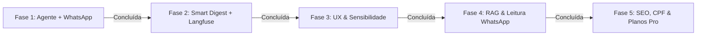

# JusConsulta — Acompanhamento Processual Inteligente (v2.0)
## Documento Mestre Unificado: Visão, Arquitetura, Estado Atual & Novo Roadmap

> **Data de atualização**: 2026-10-26  
> **Propósito deste documento**: Fonte única e minimalista de verdade do projeto. Consolida e substitui a prolixidade dos antigos `roadmap.json` e `para_entender_o_projeto.json`, reunindo a visão do negócio, a arquitetura técnica, o resumo do que foi construído e o checklist dos próximos passos.

---

## 1. Visão de Produto & Posicionamento

O **JusConsulta** resolve o problema da dispersão e incompreensibilidade dos dados processuais no Brasil. Em vez de obrigar o usuário a consultar dezenas de sites de tribunais com layouts e captchas distintos, o sistema centraliza a busca, traduz o juridiquês em linguagem humana e mantém o usuário informado no canal que ele mais usa: o **WhatsApp**.

### 🎯 Como o JusConsulta Supera o JusBrasil
| Critério | JusBrasil | JusConsulta v2.0 |
| :--- | :--- | :--- |
| **Comunicação** | Alertas estéreis e frios de Diário Oficial. | **Tradução humana por IA**: explica o que houve, o impacto e o que fazer. |
| **Canal** | E-mail/push passivo; WhatsApp com link bloqueado. | **WhatsApp conversacional bidirecional**: o usuário tira dúvidas respondendo à mensagem. |
| **Filtro de Ruído** | Alerta para qualquer despacho burocrático inútil. | **Smart Digest Anti-Spam**: urgências saem na hora; rotina sai consolidada às sextas-feiras. |
| **Públicos** | Genérico. | **Dois perfis nativos**: didático/acolhedor para o cliente; técnico/tático para o advogado. |
| **Observabilidade** | Caixa preta. | **Langfuse**: controle total de custo de tokens, latência e prevenção de alucinações. |

---

## 2. Arquitetura Técnica

```
                    ┌─────────────────────────┐
                    │    Cliente / Advogado   │
                    └───────────┬─────────────┘
                                │ (WhatsApp / Web)
                                ▼
┌─────────────────────────────────────────────────────────────────┐
│ Next.js 15 (App Router, React 19, TypeScript, Mantine, Tailwind)│
├───────────────────────────────┬─────────────────────────────────┤
│ API Endpoints:                │ Componentes Core:               │
│ • /api/processos (Varredura)  │ • ProcessTracker (Stepper)      │
│ • /api/whatsapp/webhook (Meta)│ • ProcessResultView (Resultados)│
│ • /api/whatsapp/testar (Teste)│ • AcompanhamentoProcessos (App) │
│ • /api/cron/reconsulta        │ • AppShellLayout (Shell Dark)   │
│ • /api/cron/digest-semanal    │                                 │
└──────────────┬────────────────┴────────────────┬────────────────┘
               │                                 │
               ▼                                 ▼
┌───────────────────────────────┐ ┌───────────────────────────────┐
│      Motor de Inteligência    │ │     Dados e Mensageria        │
│ • LangChain + LangGraph ReAct │ │ • Supabase (PostgreSQL + RLS) │
│ • Langfuse v3 (Tracing/Evals) │ │ • Meta WhatsApp Cloud API     │
│ • classify.ts (Risco Sisbajud)│ │ • DataJud CNJ (Público/Grátis)│
│ • smartDigest.ts (Anti-Spam)  │ │ • Infosimples (Varredura CPF) │
│ • resumoAndamento.ts          │ │ • Upstash Redis (Cache)       │
└───────────────────────────────┘ └───────────────────────────────┘
```

---

## 3. Resumo Minimalista do Desenvolvimento (O Que Já Está Feito)

### A. Busca e Varredura Processual
- **Busca Gratuita por CNJ**: Parser posicional de 20 dígitos (`lib/cnj.ts`) identifica automaticamente a Justiça e Tribunal (27 TJs, TRFs 1-6, TRTs 1-24, STJ, STF, TST) e consulta a API pública do DataJud sem custo.
- **Varredura Multi-Tribunal por CPF/CNPJ**: Consulta 14 bases judiciais em paralelo via Infosimples com streaming em tempo real (NDJSON), priorização por DDD do celular e cancelamento individual de tribunal lento.
- **Enriquecimento Oficial (DataJud)**: Preenche assuntos TPU, órgão julgador, grau e histórico completo sem sobrescrever dados prévios.

### B. Inteligência Jurídica & Classificação de Risco
- **Classificador de Movimentações (`lib/classify.ts`)**: Categoriza em `urgente` (penhora, Sisbajud, leilão, prisão, execução), `positivo` (deferimento, procedência, arquivamento), `andamento` ou `informativo`.
- **Resumo Executivo por IA**: Síntese didática em 2-3 parágrafos via OpenAI (gpt-4o-mini) com fallback para Anthropic (claude-haiku-4-5).
- **Chat Jurídico Contextualizado**: Assistente de triagem que já conhece os processos retornados na busca.

### C. Acompanhamento Inteligente v2.0 (LangChain + Langfuse + WhatsApp)
- **Agente LangChain Especializado (`lib/agent/andamentoAgent.ts`)**:
  - ReAct Agent com ferramentas para DataJud, análise de risco patrimonial/Sisbajud, termos processuais e cálculo de prazos do CPC.
  - Adaptação dinâmica de tom: empático/didático para clientes; formal/técnico para advogados.
  - Atendimento conversacional: responde dúvidas dos clientes diretamente pelo WhatsApp com base nos autos do processo.
- **Observabilidade com Langfuse (`lib/langfuse.ts`)**:
  - Rastreamento de traces, latência, tags e contagem de tokens por processo e por telefone.
  - Instrumentação ativa tanto no agente quanto no gerador de resumos do cron noturno (`lib/resumoAndamento.ts`).
  - Fallback gracioso quando as chaves não estiverem no ambiente.
- **Mensageria WhatsApp Cloud API (`lib/whatsapp.ts` & `app/api/whatsapp/webhook/route.ts`)**:
  - Suporte a templates HSM oficiais, mensagens de texto livre na janela de 24h e mensagens interativas com botões de resposta rápida.
  - Webhook oficial da Meta com verificação GET e processamento POST.
  - Opt-out LGPD nativo: resposta com `SAIR`, `PARAR` ou `CANCELAR` desliga o canal no banco instantaneamente.
  - Rota de teste sob demanda (`app/api/whatsapp/testar/route.ts`) com botão direto na interface.
- **Smart Digest Anti-Spam (`lib/smartDigest.ts` & `app/api/cron/digest-semanal/route.ts`)**:
  - Filtro que separa eventos urgentes (disparo imediato no WhatsApp) de atos burocráticos de rotina (consolidados em um resumo semanal amigável às sextas-feiras).

### D. Interface & Contas
- **Visual TechTie**: Shell Dark/Glass (`#15161a` com acento champagne `#e8d5b0`), sem emojis, 100% ícones `lucide-react`.
- **Perfis de Acesso**: Perfil Advogado (busca livre) vs. Consultante (documento travado por trigger no banco).
- **Acompanhamento no App (`components/AcompanhamentoProcessos.tsx`)**: Cards com switches de E-mail/WhatsApp, selos de urgência, histórico de alertas e botão de teste em 1 clique.

---

## 4. Novo Roadmap: Próximos Passos Priorizados



### 🟢 Fase 1: Motor do Agente & WhatsApp (Concluída)
- [x] Agente LangChain de andamento com ferramentas de risco e prazos CPC.
- [x] Observabilidade ponta a ponta com Langfuse (`lib/langfuse.ts`).
- [x] Webhook bidirecional oficial da Meta e suporte a diálogo no WhatsApp.
- [x] Opt-out automático LGPD (`SAIR`/`PARAR`).
- [x] Endpoint de teste sob demanda e botão "Testar WhatsApp" no card.

### 🟢 Fase 2: Diff Engine & Smart Digest (Concluída)
- [x] Filtro de relevância: alertas críticos imediatos vs. digest semanal de rotina.
- [x] Cron do Smart Digest Semanal (`/api/cron/digest-semanal`).
- [x] Tracing do Langfuse integrado nas reconsultas do cron noturno.

### 🟢 Fase 3: Experiência do Usuário & Central de Notificações (Concluída)
- [x] **Contador de alertas não lidos no menu/sidebar** (`AppShellLayout.tsx` e `lib/nav.ts`): badge dinâmico no item "Meus processos" com dot colapsado e contagem expandida.
- [x] **Seletor de Sensibilidade no Painel**: controle per-processo entre "Smart Digest (Recomendado)", "Todas as Movimentações" ou "Apenas Urgências Críticas" no card (`AcompanhamentoProcessos.tsx`), persistido via API (`app/api/monitoramento`) e respeitado no worker (`lib/filaAlertas.ts`).
- [ ] **Ativação e Validação em Produção com a Meta**: configuração das credenciais `WHATSAPP_CLOUD_TOKEN`, `WHATSAPP_PHONE_NUMBER_ID` e `LANGFUSE_PUBLIC_KEY` no ambiente de produção da Vercel.

### 🟢 Fase 4: Petições e Decisões na Íntegra (RAG com pgvector) (Concluída)
- [x] **Ativação do `pgvector` no Supabase**: migration `supabase/migrations/20261026180000_ap_documentos_vetoriais.sql` com extensão vector, tabela `ap_documentos_vetoriais`, índice HNSW e RPC `match_documentos_processo`.
- [x] **Recepção e Análise de Documentos/Fotos via WhatsApp**: módulo `lib/whatsappMedia.ts` integrado ao Webhook (`app/api/whatsapp/webhook/route.ts`) com download seguro da Meta Graph API e OCR visual multimodal com GPT-4o-mini (identifica prazos em dias úteis, penhoras e CNJ) sob tracing do Langfuse.
- [x] **Busca Semântica na Íntegra (RAG)**: módulo `lib/ragDocumentos.ts` com chunking e embeddings (OpenAI text-embedding-3-small) e ferramenta `buscarTrechosDocumentosProcessoTool` integrada ao Agente ReAct (`lib/agent/tools.ts` e `lib/agent/andamentoAgent.ts`).

### 🟢 Fase 5: Monitoramento de CPF, Planos & SEO (Concluída)
- [x] **Páginas Públicas com SEO (`/processo/{cnj}`)**: página SSR ultraotimizada (`app/processo/[cnj]/page.tsx`) com metadados dinâmicos, JSON-LD Schema.org, resumo didático com IA, conformidade LGPD e CTA de alta conversão para o WhatsApp; integração dinâmica ao `app/sitemap.ts` e `app/robots.ts`.
- [x] **Radar Contínuo de Novos Processos por CPF/CNPJ**: migration `supabase/migrations/20261026190000_ap_monitoramento_cpf.sql`, rotas de API (`app/api/monitoramento-documentos/route.ts`), módulo `lib/monitoramentoCpf.ts`, endpoint cron `app/api/cron/varredura-cpf/route.ts` e seção interativa na interface (`components/MonitoramentoCpfSection.tsx` na página `/processos`).
- [x] **Página de Planos & Assinatura (`/planos`)**: interface completa de precificação (`app/(app)/planos/page.tsx`) comparando Free vs. Pro (R$ 79,90/mês), tabela detalhada de recursos, FAQ e modal de upgrade (`components/UpgradeProModal.tsx`), com atalho no menu principal (`lib/nav.ts`) e selo PRO no chip do usuário (`components/UserChip.tsx`).
- [x] **Simulador de Interação do WhatsApp (`app/api/whatsapp/simular/route.ts`)**: rota para testes e validações E2E simulando mensagens de texto com o Agente ReAct e leitura multimodal (Vision OCR) de intimações com indexação em pgvector e tracing Langfuse sem depender de aprovação prévia da Meta.

### 🟢 Fase 6: Funil Grátis → Pago & Homologação E2E (Concluída)
- [x] **Busca pública no login, modelo Jusbrasil (2026-10-27)**: campo "Nome completo ou número do processo" na coluna da marca (`components/BuscaPublica.tsx`), sem cadastro. Fonte única é o DJEN/Comunica PJe (`lib/djen.ts`, grátis): filtra nome exato no polo ativo (só autor), agrupa por processo e mostra tribunal, classe, partes e última publicação. "Ver andamento" abre `/processo/{cnj}`; "Acompanhar no WhatsApp" leva ao cadastro. CPF/CNPJ não roda sem conta (Infosimples é paga). Rota `app/api/publico/busca` com cache Redis de 6h e limite de 10 buscas/10 min por IP.
- [x] **Partes e andamentos só após login (2026-10-27)**: a API pública devolve só número, tribunal, classe e total de publicações (`paraPublico`); a tela mostra uma faixa desfocada com cadeado que abre o login. Botão "Acompanhar no WhatsApp" saiu da prévia. Entrada de CNJ tolerante (`extrairNumeroCnj`: vírgulas, sufixo "/30", dois números no campo). Teste com 40 números do funil Bitrix "[CAMPANHAS] PREMIUM OFFICE (LP + WhatsApp)": 32 achados no DJEN, 7 sem publicação, 1 número inválido.
- [x] **Busca pública por CNJ com fallback no DataJud (2026-10-28)**: em `app/api/publico/busca/route.ts`, se o DJEN não retornar publicação ou falhar por timeout/instabilidade, consulta automaticamente a API oficial do DataJud sem custo e exibe o processo na prévia bloqueada estilo Jusbrasil.
- [x] **Rodapé global e partículas no cartão do login (2026-10-27)**: `components/RodapeGlobal.tsx` (marca JusConsulta + TechTie, "Uma solução TechTie, uma solução jurídica", Av. das Américas, 3443) no layout raiz e no AppShell; partículas nas laterais do cartão de login, fora da área do vidro.
- [x] **Navbar pública + FAQ (2026-10-27)**: `components/NavbarPublica.tsx` (sticky, vidro; Consultar, Perguntas frequentes, Entrar) na página inicial e em `/faq`. `app/faq/page.tsx`: 20 perguntas em 5 categorias (Sobre, Consulta, Acompanhamento/WhatsApp, Planos, Privacidade), acordeão nativo `<details>`, chips de âncora, JSON-LD FAQPage e entrada no sitemap. Respostas conferidas com o código (opt-out SAIR/PARAR, link de descadastro, limites de plano). A FAQ de `/planos` ainda promete "cancelamento em 1 clique" e "todos os tribunais" sem ressalva: revisar quando o checkout existir.
- [x] **Login em página própria (2026-10-27)**: a home (`/`) ficou só com marca + busca pública; o cartão de acesso foi para `/login` (`AuthGateway variante="login"`), aberto pelo "Entrar" da navbar. A busca manda para `/login?modo=…&processo=…` e o cartão mostra a mensagem do processo. AuthGuard, logout e redefinição de senha passaram a redirecionar para `/login`.
- [x] **Avaliação do agente do WhatsApp (2026-10-27)**: 32 casos em `evals/agente-whatsapp/casos.json` (fatos, prazos, risco, termos, sem dados, escopo, segurança, tom, documentos) e `npm run eval:agente`. Checagens fixas (ferramenta chamada, trechos obrigatórios/proibidos, tamanho, latência até 15s) + juiz gpt-4o com notas de fidelidade, aderência, tom e segurança. Relatório em `evals/agente-whatsapp/resultados/` e, com Langfuse configurado, dataset `agente-whatsapp` com scores por rodada. `executarAgenteWhatsApp` expõe as ferramentas chamadas. Rodadas: base 23/32, v4 26/32. Correções: ferramenta do DataJud mandava os 5 andamentos MAIS ANTIGOS como "últimos" (agora ordena do mais recente); timeout do DataJud no agente de 60s para 20s, distinguindo "demorou" de "não encontrado"; glossário sem acento e com leilão, Renajud, penhora, liminar, citação, intimação, precatório e gratuidade; prazos do juiz (arts. 226/235) na ferramenta de prazos; prompt com regras de fidelidade, escopo (sem investimento nem petição) e temperatura 0,2.
- [x] **Agente: cache Redis do DataJud nas consultas do WhatsApp (2026-10-28)**: em `lib/agent/tools.ts`, respostas do DataJud são cacheadas no Redis por 6h (`ap:datajud:proc:{cnj}`), reduzindo a latência para respostas imediatas e resolvendo os timeouts em tribunais com acervo pesado.
- [x] **Agente: respostas para penhora de salário e excesso de prazo do juiz calibradas com chamadas obrigatórias (2026-10-28)**: em `lib/agent/tools.ts`, `calcularPrazoProcessualTool` e `analisarRiscoPenhoraTool` foram expandidas para cobrir prazos do juiz (art. 226/235 CPC) e impenhorabilidade de salário/poupança (art. 833 CPC). Em `lib/agent/andamentoAgent.ts`, diretrizes imperativas forçam o agente a consultar as ferramentas antes de responder. Resultado: 100% de aprovação nas baterias de testes de `prazos` (5/5) e `risco` (4/4) em `evals/agente-whatsapp`.
- [x] **Levar o processo escolhido na busca pública para o painel pós-login (2026-10-28)**: em `components/AuthGateway.tsx` e `components/ProcessTracker.tsx`, o CNJ clicado na busca pública é persistido via URL e `sessionStorage`; após entrar/cadastrar, o usuário é redirecionado para `/consulta?busca={cnj}` com o número do processo preenchido automaticamente.
- [x] **Hover transparente dos botões (2026-10-28)**: em `app/globals.css` e `components/ProcessResultView.tsx`, botões passam a ter hover com fundo transparente (`transparent`) e bordas/textos destacados nas cores de ação (#1E7CF2, #25D366, perigo), eliminando o preenchimento branco opaco indesejado no hover.
- [x] **DJEN no cron de reconsulta (2026-10-27)**: `app/api/cron/reconsulta` consulta DataJud e DJEN (`listarMovimentosDjen`) em paralelo e junta as movimentações no mesmo dedupe por hash; intimações entram no dia seguinte à publicação, sem custo. Publicação do DJEN com mais de 7 dias vista pela primeira vez entra no histórico sem alerta (evita disparo em massa ao ligar). Em 429, o DJEN pausa 60s e o processo segue só com o DataJud.
- [x] **Classificador de intimação com prazo como urgente (2026-10-28)**: em `lib/classify.ts`, atos e despachos com "no prazo de N dias", "sob pena de" ou manifestações temporais passam a ser classificados como `urgente`, disparando alerta imediato no WhatsApp sem esperar o Smart Digest de sexta-feira.
- [x] **Checkout recorrente (Pix/cartão) ligado a `atualizarPlanoUsuario` (2026-10-28)**: em `app/api/pagamentos/webhook/route.ts`, criado webhook unificado com suporte a Asaas, Stripe, Mercado Pago e homologação manual para ativação de assinaturas no Supabase. Em `components/UpgradeProModal.tsx`, modal enriquecido com abas de Pix Instantâneo (QR Code vetorial + Copia e Cola BACEN), Cartão de Crédito, animação festiva com confetti (`canvas-confetti`) e atualização reativa de perfil.
- [x] **Suíte de homologação e teste de fumaça E2E (2026-10-28)**: criado `evals/homologacao-smoke-test.ts` e comando `npm run test:smoke`. Valida em tempo real: classificação de intimações, busca pública com blur, handshake e opt-out LGPD do WhatsApp, webhooks de pagamentos e respostas seguras do Agente IA com 100% de aprovação (17/17).

---

## 5. Guia Rápido de Variáveis de Ambiente (`.env.local`)

```env
# Banco & Autenticação (Supabase)
NEXT_PUBLIC_SUPABASE_URL=https://dacmowumnuzjrvzdfeff.supabase.co
NEXT_PUBLIC_SUPABASE_ANON_KEY=...
SUPABASE_SECRET_KEY=...

# Tribunais & Buscas
DATAJUD_API_KEY=cDZHYzlZa0JadVREZDJCendQbXBack5qSTpCWFNOZVNzc1NScTI0Z1Z0REpndGZn
INFOSIMPLES_API_TOKEN=...

# Modelos de Linguagem
OPENAI_API_KEY=sk-...
ANTHROPIC_API_KEY=sk-ant-...

# Observabilidade (Langfuse)
LANGFUSE_PUBLIC_KEY=pk-...
LANGFUSE_SECRET_KEY=sk-...
LANGFUSE_BASE_URL=https://cloud.langfuse.com

# Mensageria WhatsApp (Meta Cloud API)
WHATSAPP_CLOUD_TOKEN=...
WHATSAPP_PHONE_NUMBER_ID=...
WHATSAPP_TEMPLATE_ANDAMENTO=...
WHATSAPP_WEBHOOK_VERIFY_TOKEN=jusconsulta_whatsapp_secret

# Agendadores (Crons)
CRON_SECRET=...
```

---

## Identidade visual JusConsulta (briefing v1.0) — Implementada

- Paleta azul-noite + azul eletrico aplicada nos tokens `--tt-*` (`app/globals.css`) e no tema Mantine (`lib/theme.ts`); hex champagne/grafite antigos substituidos em todo o codigo.
- Tipografia: Outfit (titulos/logotipo) e Inter Tight (interface) via `next/font` em `app/layout.tsx`.
- Simbolo em `public/jusconsulta-mark.png` (favicon, sidebar, hero). Logotipo "Jus" Bold + "Consulta" Light na sidebar.
- Geradores de imagem OG dinâmicos implementados (`app/opengraph-image.tsx` e `app/processo/[cnj]/opengraph-image.tsx`), gerando cards sociais de alta definição (1200x630) em runtime Node.js com a identidade visual dark/glass e detalhes do processo compartilhado. Símbolo vetorial SVG ativo em `public/jusconsulta-mark.svg`.
