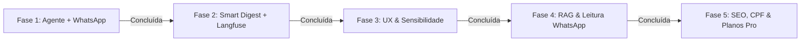

# Prosec — Acompanhamento Processual Inteligente (v2.0)
## Documento Mestre Unificado: Visão, Arquitetura, Estado Atual & Novo Roadmap

> **Data de atualização**: 2026-10-26  
> **Propósito deste documento**: Fonte única e minimalista de verdade do projeto. Consolida e substitui a prolixidade dos antigos `roadmap.json` e `para_entender_o_projeto.json`, reunindo a visão do negócio, a arquitetura técnica, o resumo do que foi construído e o checklist dos próximos passos.

---

## 1. Visão de Produto & Posicionamento

O **Prosec** resolve o problema da dispersão e incompreensibilidade dos dados processuais no Brasil. Em vez de obrigar o usuário a consultar dezenas de sites de tribunais com layouts e captchas distintos, o sistema centraliza a busca, traduz o juridiquês em linguagem humana e mantém o usuário informado no canal que ele mais usa: o **WhatsApp**.

### 🎯 Como o Prosec Supera o JusBrasil
| Critério | JusBrasil | Prosec v2.0 |
| :--- | :--- | :--- |
| **Comunicação** | Alertas estéreis e frios de Diário Oficial. | **Tradução humana por IA**: explica o que houve, o impacto e o que fazer. |
| **Canal** | E-mail/push passivo; WhatsApp com link bloqueado. | **WhatsApp conversacional bidirecional**: o usuário tira dúvidas respondendo à mensagem. |
| **Filtro de Ruído** | Alerta para qualquer despacho burocrático inútil. | **Smart Digest Anti-Spam**: urgências saem na hora; rotina sai consolidada às sextas-feiras. |
| **Públicos** | Genérico. | **Dois perfis nativos**: didático/acolhedor para o cliente; técnico/tático para o advogado. |
| **Observabilidade** | Caixa preta. | **Langfuse**: controle total de custo de tokens, latência e prevenção de alucinações. |

---

## 2. Arquitetura Técnica

```
                    ┌─────────────────────────┐
                    │    Cliente / Advogado   │
                    └───────────┬─────────────┘
                                │ (WhatsApp / Web)
                                ▼
┌─────────────────────────────────────────────────────────────────┐
│ Next.js 15 (App Router, React 19, TypeScript, Mantine, Tailwind)│
├───────────────────────────────┬─────────────────────────────────┤
│ API Endpoints:                │ Componentes Core:               │
│ • /api/processos (Varredura)  │ • ProcessTracker (Stepper)      │
│ • /api/whatsapp/webhook (Meta)│ • ProcessResultView (Resultados)│
│ • /api/whatsapp/testar (Teste)│ • AcompanhamentoProcessos (App) │
│ • /api/cron/reconsulta        │ • AppShellLayout (Shell Dark)   │
│ • /api/cron/digest-semanal    │                                 │
└──────────────┬────────────────┴────────────────┬────────────────┘
               │                                 │
               ▼                                 ▼
┌───────────────────────────────┐ ┌───────────────────────────────┐
│      Motor de Inteligência    │ │     Dados e Mensageria        │
│ • LangChain + LangGraph ReAct │ │ • Supabase (PostgreSQL + RLS) │
│ • Langfuse v3 (Tracing/Evals) │ │ • Meta WhatsApp Cloud API     │
│ • classify.ts (Risco Sisbajud)│ │ • DataJud CNJ (Público/Grátis)│
│ • smartDigest.ts (Anti-Spam)  │ │ • Infosimples (Varredura CPF) │
│ • resumoAndamento.ts          │ │ • Upstash Redis (Cache)       │
└───────────────────────────────┘ └───────────────────────────────┘
```

---

## 3. Resumo Minimalista do Desenvolvimento (O Que Já Está Feito)

### A. Busca e Varredura Processual
- **Busca Gratuita por CNJ**: Parser posicional de 20 dígitos (`lib/cnj.ts`) identifica automaticamente a Justiça e Tribunal (27 TJs, TRFs 1-6, TRTs 1-24, STJ, STF, TST) e consulta a API pública do DataJud sem custo.
- **Varredura Multi-Tribunal por CPF/CNPJ**: Consulta 14 bases judiciais em paralelo via Infosimples com streaming em tempo real (NDJSON), priorização por DDD do celular e cancelamento individual de tribunal lento.
- **Enriquecimento Oficial (DataJud)**: Preenche assuntos TPU, órgão julgador, grau e histórico completo sem sobrescrever dados prévios.

### B. Inteligência Jurídica & Classificação de Risco
- **Classificador de Movimentações (`lib/classify.ts`)**: Categoriza em `urgente` (penhora, Sisbajud, leilão, prisão, execução), `positivo` (deferimento, procedência, arquivamento), `andamento` ou `informativo`.
- **Resumo Executivo por IA**: Síntese didática em 2-3 parágrafos via OpenAI (gpt-4o-mini) com fallback para Anthropic (claude-haiku-4-5).
- **Chat Jurídico Contextualizado**: Assistente de triagem que já conhece os processos retornados na busca.

### C. Acompanhamento Inteligente v2.0 (LangChain + Langfuse + WhatsApp)
- **Agente LangChain Especializado (`lib/agent/andamentoAgent.ts`)**:
  - ReAct Agent com ferramentas para DataJud, análise de risco patrimonial/Sisbajud, termos processuais e cálculo de prazos do CPC.
  - Adaptação dinâmica de tom: empático/didático para clientes; formal/técnico para advogados.
  - Atendimento conversacional: responde dúvidas dos clientes diretamente pelo WhatsApp com base nos autos do processo.
- **Observabilidade com Langfuse (`lib/langfuse.ts`)**:
  - Rastreamento de traces, latência, tags e contagem de tokens por processo e por telefone.
  - Instrumentação ativa tanto no agente quanto no gerador de resumos do cron noturno (`lib/resumoAndamento.ts`).
  - Fallback gracioso quando as chaves não estiverem no ambiente.
- **Mensageria WhatsApp Cloud API (`lib/whatsapp.ts` & `app/api/whatsapp/webhook/route.ts`)**:
  - Suporte a templates HSM oficiais, mensagens de texto livre na janela de 24h e mensagens interativas com botões de resposta rápida.
  - Webhook oficial da Meta com verificação GET e processamento POST.
  - Opt-out LGPD nativo: resposta com `SAIR`, `PARAR` ou `CANCELAR` desliga o canal no banco instantaneamente.
  - Rota de teste sob demanda (`app/api/whatsapp/testar/route.ts`) com botão direto na interface.
- **Smart Digest Anti-Spam (`lib/smartDigest.ts` & `app/api/cron/digest-semanal/route.ts`)**:
  - Filtro que separa eventos urgentes (disparo imediato no WhatsApp) de atos burocráticos de rotina (consolidados em um resumo semanal amigável às sextas-feiras).

### D. Interface & Contas
- **Visual TechTie**: Shell Dark/Glass (`#15161a` com acento champagne `#e8d5b0`), sem emojis, 100% ícones `lucide-react`.
- **Perfis de Acesso**: Perfil Advogado (busca livre) vs. Consultante (documento travado por trigger no banco).
- **Acompanhamento no App (`components/AcompanhamentoProcessos.tsx`)**: Cards com switches de E-mail/WhatsApp, selos de urgência, histórico de alertas e botão de teste em 1 clique.

---

## 4. Novo Roadmap: Próximos Passos Priorizados



### 🟢 Fase 1: Motor do Agente & WhatsApp (Concluída)
- [x] Agente LangChain de andamento com ferramentas de risco e prazos CPC.
- [x] Observabilidade ponta a ponta com Langfuse (`lib/langfuse.ts`).
- [x] Webhook bidirecional oficial da Meta e suporte a diálogo no WhatsApp.
- [x] Opt-out automático LGPD (`SAIR`/`PARAR`).
- [x] Endpoint de teste sob demanda e botão "Testar WhatsApp" no card.

### 🟢 Fase 2: Diff Engine & Smart Digest (Concluída)
- [x] Filtro de relevância: alertas críticos imediatos vs. digest semanal de rotina.
- [x] Cron do Smart Digest Semanal (`/api/cron/digest-semanal`).
- [x] Tracing do Langfuse integrado nas reconsultas do cron noturno.

### 🟢 Fase 3: Experiência do Usuário & Central de Notificações (Concluída)
- [x] **Contador de alertas não lidos no menu/sidebar** (`AppShellLayout.tsx` e `lib/nav.ts`): badge dinâmico no item "Meus processos" com dot colapsado e contagem expandida.
- [x] **Seletor de Sensibilidade no Painel**: controle per-processo entre "Smart Digest (Recomendado)", "Todas as Movimentações" ou "Apenas Urgências Críticas" no card (`AcompanhamentoProcessos.tsx`), persistido via API (`app/api/monitoramento`) e respeitado no worker (`lib/filaAlertas.ts`).
- [ ] **Ativação e Validação em Produção com a Meta**: configuração das credenciais `WHATSAPP_CLOUD_TOKEN`, `WHATSAPP_PHONE_NUMBER_ID` e `LANGFUSE_PUBLIC_KEY` no ambiente de produção da Vercel.

### 🟢 Fase 4: Petições e Decisões na Íntegra (RAG com pgvector) (Concluída)
- [x] **Ativação do `pgvector` no Supabase**: migration `supabase/migrations/20261026180000_ap_documentos_vetoriais.sql` com extensão vector, tabela `ap_documentos_vetoriais`, índice HNSW e RPC `match_documentos_processo`.
- [x] **Recepção e Análise de Documentos/Fotos via WhatsApp**: módulo `lib/whatsappMedia.ts` integrado ao Webhook (`app/api/whatsapp/webhook/route.ts`) com download seguro da Meta Graph API e OCR visual multimodal com GPT-4o-mini (identifica prazos em dias úteis, penhoras e CNJ) sob tracing do Langfuse.
- [x] **Busca Semântica na Íntegra (RAG)**: módulo `lib/ragDocumentos.ts` com chunking e embeddings (OpenAI text-embedding-3-small) e ferramenta `buscarTrechosDocumentosProcessoTool` integrada ao Agente ReAct (`lib/agent/tools.ts` e `lib/agent/andamentoAgent.ts`).

### 🟢 Fase 5: Monitoramento de CPF, Planos & SEO (Concluída)
- [x] **Páginas Públicas com SEO (`/processo/{cnj}`)**: página SSR ultraotimizada (`app/processo/[cnj]/page.tsx`) com metadados dinâmicos, JSON-LD Schema.org, resumo didático com IA, conformidade LGPD e CTA de alta conversão para o WhatsApp; integração dinâmica ao `app/sitemap.ts` e `app/robots.ts`.
- [x] **Radar Contínuo de Novos Processos por CPF/CNPJ**: migration `supabase/migrations/20261026190000_ap_monitoramento_cpf.sql`, rotas de API (`app/api/monitoramento-documentos/route.ts`), módulo `lib/monitoramentoCpf.ts`, endpoint cron `app/api/cron/varredura-cpf/route.ts` e seção interativa na interface (`components/MonitoramentoCpfSection.tsx` na página `/processos`).
- [x] **Página de Planos & Assinatura (`/planos`)**: interface completa de precificação (`app/(app)/planos/page.tsx`) comparando Free vs. Pro (R$ 79,90/mês), tabela detalhada de recursos, FAQ e modal de upgrade (`components/UpgradeProModal.tsx`), com atalho no menu principal (`lib/nav.ts`) e selo PRO no chip do usuário (`components/UserChip.tsx`).
- [x] **Simulador de Interação do WhatsApp (`app/api/whatsapp/simular/route.ts`)**: rota para testes e validações E2E simulando mensagens de texto com o Agente ReAct e leitura multimodal (Vision OCR) de intimações com indexação em pgvector e tracing Langfuse sem depender de aprovação prévia da Meta.

---

## 5. Guia Rápido de Variáveis de Ambiente (`.env.local`)

```env
# Banco & Autenticação (Supabase)
NEXT_PUBLIC_SUPABASE_URL=https://dacmowumnuzjrvzdfeff.supabase.co
NEXT_PUBLIC_SUPABASE_ANON_KEY=...
SUPABASE_SECRET_KEY=...

# Tribunais & Buscas
DATAJUD_API_KEY=cDZHYzlZa0JadVREZDJCendQbXBack5qSTpCWFNOZVNzc1NScTI0Z1Z0REpndGZn
INFOSIMPLES_API_TOKEN=...

# Modelos de Linguagem
OPENAI_API_KEY=sk-...
ANTHROPIC_API_KEY=sk-ant-...

# Observabilidade (Langfuse)
LANGFUSE_PUBLIC_KEY=pk-...
LANGFUSE_SECRET_KEY=sk-...
LANGFUSE_BASE_URL=https://cloud.langfuse.com

# Mensageria WhatsApp (Meta Cloud API)
WHATSAPP_CLOUD_TOKEN=...
WHATSAPP_PHONE_NUMBER_ID=...
WHATSAPP_TEMPLATE_ANDAMENTO=...
WHATSAPP_WEBHOOK_VERIFY_TOKEN=prosec_whatsapp_secret

# Agendadores (Crons)
CRON_SECRET=...
```
