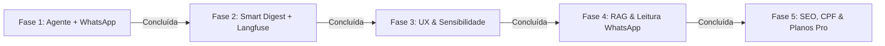

# JusConsulta — Acompanhamento Processual Inteligente (v2.0)
## Documento Mestre Unificado: Visão, Arquitetura, Estado Atual & Novo Roadmap

> **Data de atualização**: 2026-10-26  
> **Propósito deste documento**: Fonte única e minimalista de verdade do projeto. Consolida e substitui a prolixidade dos antigos `roadmap.json` e `para_entender_o_projeto.json`, reunindo a visão do negócio, a arquitetura técnica, o resumo do que foi construído e o checklist dos próximos passos.

---

## 1. Visão de Produto & Posicionamento

O **JusConsulta** resolve o problema da dispersão e incompreensibilidade dos dados processuais no Brasil. Em vez de obrigar o usuário a consultar dezenas de sites de tribunais com layouts e captchas distintos, o sistema centraliza a busca, traduz o juridiquês em linguagem humana e mantém o usuário informado no canal que ele mais usa: o **WhatsApp**.

### 🎯 Como o JusConsulta Supera o JusBrasil
| Critério | JusBrasil | JusConsulta v2.0 |
| :--- | :--- | :--- |
| **Comunicação** | Alertas estéreis e frios de Diário Oficial. | **Tradução humana por IA**: explica o que houve, o impacto e o que fazer. |
| **Canal** | E-mail/push passivo; WhatsApp com link bloqueado. | **WhatsApp conversacional bidirecional**: o usuário tira dúvidas respondendo à mensagem. |
| **Filtro de Ruído** | Alerta para qualquer despacho burocrático inútil. | **Smart Digest Anti-Spam**: urgências saem na hora; rotina sai consolidada às sextas-feiras. |
| **Públicos** | Genérico. | **Dois perfis nativos**: didático/acolhedor para o cliente; técnico/tático para o advogado. |
| **Observabilidade** | Caixa preta. | **Langfuse**: controle total de custo de tokens, latência e prevenção de alucinações. |

---

## 2. Arquitetura Técnica

```
                    ┌─────────────────────────┐
                    │    Cliente / Advogado   │
                    └───────────┬─────────────┘
                                │ (WhatsApp / Web)
                                ▼
┌─────────────────────────────────────────────────────────────────┐
│ Next.js 15 (App Router, React 19, TypeScript, Mantine, Tailwind)│
├───────────────────────────────┬─────────────────────────────────┤
│ API Endpoints:                │ Componentes Core:               │
│ • /api/processos (Varredura)  │ • ProcessTracker (Stepper)      │
│ • /api/whatsapp/webhook (Meta)│ • ProcessResultView (Resultados)│
│ • /api/whatsapp/testar (Teste)│ • AcompanhamentoProcessos (App) │
│ • /api/cron/reconsulta        │ • AppShellLayout (Shell Dark)   │
│ • /api/cron/digest-semanal    │                                 │
└──────────────┬────────────────┴────────────────┬────────────────┘
               │                                 │
               ▼                                 ▼
┌───────────────────────────────┐ ┌───────────────────────────────┐
│      Motor de Inteligência    │ │     Dados e Mensageria        │
│ • LangChain + LangGraph ReAct │ │ • Supabase (PostgreSQL + RLS) │
│ • Langfuse v3 (Tracing/Evals) │ │ • Meta WhatsApp Cloud API     │
│ • classify.ts (Risco Sisbajud)│ │ • DataJud CNJ (Público/Grátis)│
│ • smartDigest.ts (Anti-Spam)  │ │ • Infosimples (Varredura CPF) │
│ • resumoAndamento.ts          │ │ • Upstash Redis (Cache)       │
└───────────────────────────────┘ └───────────────────────────────┘
```

---

## 3. Resumo Minimalista do Desenvolvimento (O Que Já Está Feito)

### A. Busca e Varredura Processual
- **Busca Gratuita por CNJ**: Parser posicional de 20 dígitos (`lib/cnj.ts`) identifica automaticamente a Justiça e Tribunal (27 TJs, TRFs 1-6, TRTs 1-24, STJ, STF, TST) e consulta a API pública do DataJud sem custo.
- **Varredura Multi-Tribunal por CPF/CNPJ**: Consulta 14 bases judiciais em paralelo via Infosimples com streaming em tempo real (NDJSON), priorização por DDD do celular e cancelamento individual de tribunal lento.
- **Enriquecimento Oficial (DataJud)**: Preenche assuntos TPU, órgão julgador, grau e histórico completo sem sobrescrever dados prévios.

### B. Inteligência Jurídica & Classificação de Risco
- **Classificador de Movimentações (`lib/classify.ts`)**: Categoriza em `urgente` (penhora, Sisbajud, leilão, prisão, execução), `positivo` (deferimento, procedência, arquivamento), `andamento` ou `informativo`.
- **Resumo Executivo por IA**: Síntese didática em 2-3 parágrafos via OpenAI (gpt-4o-mini) com fallback para Anthropic (claude-haiku-4-5).
- **Chat Jurídico Contextualizado**: Assistente de triagem que já conhece os processos retornados na busca.

### C. Acompanhamento Inteligente v2.0 (LangChain + Langfuse + WhatsApp)
- **Agente LangChain Especializado (`lib/agent/andamentoAgent.ts`)**:
  - ReAct Agent com ferramentas para DataJud, análise de risco patrimonial/Sisbajud, termos processuais e cálculo de prazos do CPC.
  - Adaptação dinâmica de tom: empático/didático para clientes; formal/técnico para advogados.
  - Atendimento conversacional: responde dúvidas dos clientes diretamente pelo WhatsApp com base nos autos do processo.
- **Observabilidade com Langfuse (`lib/langfuse.ts`)**:
  - Rastreamento de traces, latência, tags e contagem de tokens por processo e por telefone.
  - Instrumentação ativa tanto no agente quanto no gerador de resumos do cron noturno (`lib/resumoAndamento.ts`).
  - Fallback gracioso quando as chaves não estiverem no ambiente.
- **Mensageria WhatsApp Cloud API (`lib/whatsapp.ts` & `app/api/whatsapp/webhook/route.ts`)**:
  - Suporte a templates HSM oficiais, mensagens de texto livre na janela de 24h e mensagens interativas com botões de resposta rápida.
  - Webhook oficial da Meta com verificação GET e processamento POST.
  - Opt-out LGPD nativo: resposta com `SAIR`, `PARAR` ou `CANCELAR` desliga o canal no banco instantaneamente.
  - Rota de teste sob demanda (`app/api/whatsapp/testar/route.ts`) com botão direto na interface.
- **Smart Digest Anti-Spam (`lib/smartDigest.ts` & `app/api/cron/digest-semanal/route.ts`)**:
  - Filtro que separa eventos urgentes (disparo imediato no WhatsApp) de atos burocráticos de rotina (consolidados em um resumo semanal amigável às sextas-feiras).

### D. Interface & Contas
- **Visual TechTie**: Shell Dark/Glass (`#15161a` com acento champagne `#e8d5b0`), sem emojis, 100% ícones `lucide-react`.
- **Perfis de Acesso**: Perfil Advogado (busca livre) vs. Consultante (documento travado por trigger no banco).
- **Acompanhamento no App (`components/AcompanhamentoProcessos.tsx`)**: Cards com switches de E-mail/WhatsApp, selos de urgência, histórico de alertas e botão de teste em 1 clique.

---

## 4. Novo Roadmap: Próximos Passos Priorizados



### 🟢 Fase 1: Motor do Agente & WhatsApp (Concluída)
- [x] Agente LangChain de andamento com ferramentas de risco e prazos CPC.
- [x] Observabilidade ponta a ponta com Langfuse (`lib/langfuse.ts`).
- [x] Webhook bidirecional oficial da Meta e suporte a diálogo no WhatsApp.
- [x] Opt-out automático LGPD (`SAIR`/`PARAR`).
- [x] Endpoint de teste sob demanda e botão "Testar WhatsApp" no card.

### 🟢 Fase 2: Diff Engine & Smart Digest (Concluída)
- [x] Filtro de relevância: alertas críticos imediatos vs. digest semanal de rotina.
- [x] Cron do Smart Digest Semanal (`/api/cron/digest-semanal`).
- [x] Tracing do Langfuse integrado nas reconsultas do cron noturno.

### 🟢 Fase 3: Experiência do Usuário & Central de Notificações (Concluída)
- [x] **Contador de alertas não lidos no menu/sidebar** (`AppShellLayout.tsx` e `lib/nav.ts`): badge dinâmico no item "Meus processos" com dot colapsado e contagem expandida.
- [x] **Seletor de Sensibilidade no Painel**: controle per-processo entre "Smart Digest (Recomendado)", "Todas as Movimentações" ou "Apenas Urgências Críticas" no card (`AcompanhamentoProcessos.tsx`), persistido via API (`app/api/monitoramento`) e respeitado no worker (`lib/filaAlertas.ts`).
- [ ] **Ativação e Validação em Produção com a Meta**: configuração das credenciais `WHATSAPP_CLOUD_TOKEN`, `WHATSAPP_PHONE_NUMBER_ID` e `LANGFUSE_PUBLIC_KEY` no ambiente de produção da Vercel.

### 🟢 Fase 4: Petições e Decisões na Íntegra (RAG com pgvector) (Concluída)
- [x] **Ativação do `pgvector` no Supabase**: migration `supabase/migrations/20261026180000_ap_documentos_vetoriais.sql` com extensão vector, tabela `ap_documentos_vetoriais`, índice HNSW e RPC `match_documentos_processo`.
- [x] **Recepção e Análise de Documentos/Fotos via WhatsApp**: módulo `lib/whatsappMedia.ts` integrado ao Webhook (`app/api/whatsapp/webhook/route.ts`) com download seguro da Meta Graph API e OCR visual multimodal com GPT-4o-mini (identifica prazos em dias úteis, penhoras e CNJ) sob tracing do Langfuse.
- [x] **Busca Semântica na Íntegra (RAG)**: módulo `lib/ragDocumentos.ts` com chunking e embeddings (OpenAI text-embedding-3-small) e ferramenta `buscarTrechosDocumentosProcessoTool` integrada ao Agente ReAct (`lib/agent/tools.ts` e `lib/agent/andamentoAgent.ts`).

### 🟢 Fase 5: Monitoramento de CPF, Planos & SEO (Concluída)
- [x] **Páginas Públicas com SEO (`/processo/{cnj}`)**: página SSR ultraotimizada (`app/processo/[cnj]/page.tsx`) com metadados dinâmicos, JSON-LD Schema.org, resumo didático com IA, conformidade LGPD e CTA de alta conversão para o WhatsApp; integração dinâmica ao `app/sitemap.ts` e `app/robots.ts`.
- [x] **Radar Contínuo de Novos Processos por CPF/CNPJ**: migration `supabase/migrations/20261026190000_ap_monitoramento_cpf.sql`, rotas de API (`app/api/monitoramento-documentos/route.ts`), módulo `lib/monitoramentoCpf.ts`, endpoint cron `app/api/cron/varredura-cpf/route.ts` e seção interativa na interface (`components/MonitoramentoCpfSection.tsx` na página `/processos`).
- [x] **Página de Planos & Assinatura (`/planos`)**: interface completa de precificação (`app/(app)/planos/page.tsx`) comparando Free vs. Pro (R$ 79,90/mês), tabela detalhada de recursos, FAQ e modal de upgrade (`components/UpgradeProModal.tsx`), com atalho no menu principal (`lib/nav.ts`) e selo PRO no chip do usuário (`components/UserChip.tsx`).
- [x] **Simulador de Interação do WhatsApp (`app/api/whatsapp/simular/route.ts`)**: rota para testes e validações E2E simulando mensagens de texto com o Agente ReAct e leitura multimodal (Vision OCR) de intimações com indexação em pgvector e tracing Langfuse sem depender de aprovação prévia da Meta.

### 🟢 Fase 6: Funil Grátis → Pago & Homologação E2E (Concluída)
- [x] **Busca pública no login, modelo Jusbrasil (2026-10-27)**: campo "Nome completo ou número do processo" na coluna da marca (`components/BuscaPublica.tsx`), sem cadastro. Fonte única é o DJEN/Comunica PJe (`lib/djen.ts`, grátis): filtra nome exato no polo ativo (só autor), agrupa por processo e mostra tribunal, classe, partes e última publicação. "Ver andamento" abre `/processo/{cnj}`; "Acompanhar no WhatsApp" leva ao cadastro. CPF/CNPJ não roda sem conta (Infosimples é paga). Rota `app/api/publico/busca` com cache Redis de 6h e limite de 10 buscas/10 min por IP.
- [x] **Partes e andamentos só após login (2026-10-27)**: a API pública devolve só número, tribunal, classe e total de publicações (`paraPublico`); a tela mostra uma faixa desfocada com cadeado que abre o login. Botão "Acompanhar no WhatsApp" saiu da prévia. Entrada de CNJ tolerante (`extrairNumeroCnj`: vírgulas, sufixo "/30", dois números no campo). Teste com 40 números do funil Bitrix "[CAMPANHAS] PREMIUM OFFICE (LP + WhatsApp)": 32 achados no DJEN, 7 sem publicação, 1 número inválido.
- [x] **Busca pública por CNJ com fallback no DataJud (2026-10-28)**: em `app/api/publico/busca/route.ts`, se o DJEN não retornar publicação ou falhar por timeout/instabilidade, consulta automaticamente a API oficial do DataJud sem custo e exibe o processo na prévia bloqueada estilo Jusbrasil.
- [x] **Rodapé global e partículas no cartão do login (2026-10-27)**: `components/RodapeGlobal.tsx` (marca JusConsulta + TechTie, "Uma solução TechTie, uma solução jurídica", Av. das Américas, 3443) no layout raiz e no AppShell; partículas nas laterais do cartão de login, fora da área do vidro. (2026-11-05) Rodapé agora em todas as rotas do AppShell, inclusive `/painel` (exceção `ROTAS_SEM_RODAPE` removida).
- [x] **Navbar pública + FAQ (2026-10-27)**: `components/NavbarPublica.tsx` (sticky, vidro; Consultar, Perguntas frequentes, Entrar) na página inicial e em `/faq`. `app/faq/page.tsx`: 20 perguntas em 5 categorias (Sobre, Consulta, Acompanhamento/WhatsApp, Planos, Privacidade), acordeão nativo `<details>`, chips de âncora, JSON-LD FAQPage e entrada no sitemap. Respostas conferidas com o código (opt-out SAIR/PARAR, link de descadastro, limites de plano). A FAQ de `/planos` ainda promete "cancelamento em 1 clique" e "todos os tribunais" sem ressalva: revisar quando o checkout existir.
- [x] **Login em página própria (2026-10-27)**: a home (`/`) ficou só com marca + busca pública; o cartão de acesso foi para `/login` (`AuthGateway variante="login"`), aberto pelo "Entrar" da navbar. A busca manda para `/login?modo=…&processo=…` e o cartão mostra a mensagem do processo. AuthGuard, logout e redefinição de senha passaram a redirecionar para `/login`.
- [x] **Avaliação do agente do WhatsApp (2026-10-27)**: 32 casos em `evals/agente-whatsapp/casos.json` (fatos, prazos, risco, termos, sem dados, escopo, segurança, tom, documentos) e `npm run eval:agente`. Checagens fixas (ferramenta chamada, trechos obrigatórios/proibidos, tamanho, latência até 15s) + juiz gpt-4o com notas de fidelidade, aderência, tom e segurança. Relatório em `evals/agente-whatsapp/resultados/` e, com Langfuse configurado, dataset `agente-whatsapp` com scores por rodada. `executarAgenteWhatsApp` expõe as ferramentas chamadas. Rodadas: base 23/32, v4 26/32. Correções: ferramenta do DataJud mandava os 5 andamentos MAIS ANTIGOS como "últimos" (agora ordena do mais recente); timeout do DataJud no agente de 60s para 20s, distinguindo "demorou" de "não encontrado"; glossário sem acento e com leilão, Renajud, penhora, liminar, citação, intimação, precatório e gratuidade; prazos do juiz (arts. 226/235) na ferramenta de prazos; prompt com regras de fidelidade, escopo (sem investimento nem petição) e temperatura 0,2.
- [x] **Agente: cache Redis do DataJud nas consultas do WhatsApp (2026-10-28)**: em `lib/agent/tools.ts`, respostas do DataJud são cacheadas no Redis por 6h (`ap:datajud:proc:{cnj}`), reduzindo a latência para respostas imediatas e resolvendo os timeouts em tribunais com acervo pesado.
- [x] **Agente: respostas para penhora de salário e excesso de prazo do juiz calibradas com chamadas obrigatórias (2026-10-28)**: em `lib/agent/tools.ts`, `calcularPrazoProcessualTool` e `analisarRiscoPenhoraTool` foram expandidas para cobrir prazos do juiz (art. 226/235 CPC) e impenhorabilidade de salário/poupança (art. 833 CPC). Em `lib/agent/andamentoAgent.ts`, diretrizes imperativas forçam o agente a consultar as ferramentas antes de responder. Resultado: 100% de aprovação nas baterias de testes de `prazos` (5/5) e `risco` (4/4) em `evals/agente-whatsapp`.
- [x] **Levar o processo escolhido na busca pública para o painel pós-login (2026-10-28)**: em `components/AuthGateway.tsx` e `components/ProcessTracker.tsx`, o CNJ clicado na busca pública é persistido via URL e `sessionStorage`; após entrar/cadastrar, o usuário é redirecionado para `/consulta?busca={cnj}` com o número do processo preenchido automaticamente.
- [x] **Hover transparente dos botões (2026-10-28)**: em `app/globals.css` e `components/ProcessResultView.tsx`, botões passam a ter hover com fundo transparente (`transparent`) e bordas/textos destacados nas cores de ação (#1E7CF2, #25D366, perigo), eliminando o preenchimento branco opaco indesejado no hover.
- [x] **DJEN no cron de reconsulta (2026-10-27)**: `app/api/cron/reconsulta` consulta DataJud e DJEN (`listarMovimentosDjen`) em paralelo e junta as movimentações no mesmo dedupe por hash; intimações entram no dia seguinte à publicação, sem custo. Publicação do DJEN com mais de 7 dias vista pela primeira vez entra no histórico sem alerta (evita disparo em massa ao ligar). Em 429, o DJEN pausa 60s e o processo segue só com o DataJud.
- [x] **Classificador de intimação com prazo como urgente (2026-10-28)**: em `lib/classify.ts`, atos e despachos com "no prazo de N dias", "sob pena de" ou manifestações temporais passam a ser classificados como `urgente`, disparando alerta imediato no WhatsApp sem esperar o Smart Digest de sexta-feira.
- [x] **Checkout recorrente (Pix/cartão) ligado a `atualizarPlanoUsuario` (2026-10-28)**: em `app/api/pagamentos/webhook/route.ts`, criado webhook unificado com suporte a Asaas, Stripe, Mercado Pago e homologação manual para ativação de assinaturas no Supabase. Em `components/UpgradeProModal.tsx`, modal enriquecido com abas de Pix Instantâneo (QR Code vetorial + Copia e Cola BACEN), Cartão de Crédito, animação festiva com confetti (`canvas-confetti`) e atualização reativa de perfil.
- [x] **Indicador de créditos no topo (2026-11-04)**: `components/CreditosChip.tsx` no `AppShellLayout` mostra o saldo da franquia mensal de consultas pagas (soma de `custo_cobrado` em `ap_historico_consultas` no mês), barra por faixa de uso e data de renovação (dia 1º). Franquia em `REGRAS_PLANOS` (`lib/planos.ts`), ajustável por `FRANQUIA_MENSAL_FREE_REAIS`/`FRANQUIA_MENSAL_PRO_REAIS` (padrão R$ 5 / R$ 40, a confirmar). Ainda não bloqueia a busca quando o saldo acaba.
- [x] **Escolha manual de fontes removida (2026-11-04)**: busca por pessoa/empresa e por nome usam só as fontes padrão; o seletor ficou apenas na busca por número (`components/ProcessTracker.tsx`).
- [ ] **Pagamento real via Asaas (2026-11-04, código pronto)**: `lib/asaas.ts` (cliente v3) e `lib/assinaturas.ts` (assinatura mensal, Pix com QR Code real e cartão pela página segura do Asaas). Rota `app/api/pagamentos/assinatura` (POST gera a cobrança; GET consulta o status e ativa o Pro se pago, o que funciona sem webhook no localhost). Webhook reescrito: exige `asaas-access-token` = `ASAAS_WEBHOOK_TOKEN`, só age sobre assinaturas de `ap_assinaturas` (a conta Asaas é compartilhada com outros negócios), trata pago, inadimplência, estorno e cancelamento. Removidos os ramos Stripe, Mercado Pago e o "manual de homologação", que ativavam o Pro sem autenticação. `POST /api/planos` não promove mais a Pro (só admin/owner); voltar ao Gratuito cancela a assinatura no Asaas. **Pendente**: testar no sandbox do Asaas, cadastrar o webhook no painel do Asaas e configurar as variáveis na Vercel. (2026-11-09: tabela `ap_assinaturas` confirmada no Supabase com estrutura, RLS e policy idênticas à migration `20261104120000`; não consta no histórico de migrations, mas não precisa reaplicar. O `.env.local` ainda tem chave de produção; o teste usará chave sandbox.)
- [x] **Suíte de homologação e teste de fumaça E2E (2026-10-28)**: criado `evals/homologacao-smoke-test.ts` e comando `npm run test:smoke`. Valida em tempo real: classificação de intimações, busca pública com blur, handshake e opt-out LGPD do WhatsApp, webhooks de pagamentos e respostas seguras do Agente IA com 100% de aprovação (17/17).

---

## 5. Guia Rápido de Variáveis de Ambiente (`.env.local`)

```env
# Banco & Autenticação (Supabase)
NEXT_PUBLIC_SUPABASE_URL=https://dacmowumnuzjrvzdfeff.supabase.co
NEXT_PUBLIC_SUPABASE_ANON_KEY=...
SUPABASE_SECRET_KEY=...

# Tribunais & Buscas
DATAJUD_API_KEY=cDZHYzlZa0JadVREZDJCendQbXBack5qSTpCWFNOZVNzc1NScTI0Z1Z0REpndGZn
INFOSIMPLES_API_TOKEN=...

# Modelos de Linguagem
OPENAI_API_KEY=sk-...
ANTHROPIC_API_KEY=sk-ant-...

# Observabilidade (Langfuse)
LANGFUSE_PUBLIC_KEY=pk-...
LANGFUSE_SECRET_KEY=sk-...
LANGFUSE_BASE_URL=https://cloud.langfuse.com

# Mensageria WhatsApp (Meta Cloud API)
WHATSAPP_CLOUD_TOKEN=...
WHATSAPP_PHONE_NUMBER_ID=...
WHATSAPP_TEMPLATE_ANDAMENTO=...
WHATSAPP_WEBHOOK_VERIFY_TOKEN=jusconsulta_whatsapp_secret

# Agendadores (Crons)
CRON_SECRET=...

# Pagamentos (Asaas). No .env.local o "$" inicial da chave vai escapado (\$aact_...); na Vercel, sem escape.
ASAAS_API_KEY=\$aact_...
ASAAS_WEBHOOK_TOKEN=...          # o mesmo token cadastrado no webhook do painel Asaas
# ASAAS_API_URL=https://api-sandbox.asaas.com/v3   # opcional: força sandbox
# FRANQUIA_MENSAL_FREE_REAIS=5  /  FRANQUIA_MENSAL_PRO_REAIS=40
```

---

## Identidade visual JusConsulta (briefing v1.0) — Implementada

- Paleta azul-noite + azul eletrico aplicada nos tokens `--tt-*` (`app/globals.css`) e no tema Mantine (`lib/theme.ts`); hex champagne/grafite antigos substituidos em todo o codigo.
- Tipografia: Outfit (titulos/logotipo) e Inter Tight (interface) via `next/font` em `app/layout.tsx`.
- Simbolo em `public/jusconsulta-mark.png` (favicon, sidebar, hero). Logotipo "Jus" Bold + "Consulta" Light na sidebar.
- Geradores de imagem OG dinâmicos implementados (`app/opengraph-image.tsx` e `app/processo/[cnj]/opengraph-image.tsx`), gerando cards sociais de alta definição (1200x630) em runtime Node.js com a identidade visual dark/glass e detalhes do processo compartilhado. Símbolo vetorial SVG ativo em `public/jusconsulta-mark.svg`.

---

## Perfil de acesso perguntado após o primeiro login — Implementada

- O cadastro (`components/AuthGateway.tsx`) pede só nome, e-mail e senha (ou Google): saiu o seletor Advogado/Broker/Consulta Avulsa e o campo CPF/CNPJ.
- Novo `components/PerfilOnboarding.tsx` (montado no `AppShellLayout`): modal sem fechar que aparece enquanto a conta é `cliente` sem documento. Advogado/Broker atualiza o `role`; Consulta Avulsa fixa CPF/CNPJ validado. Usa a transição que o trigger `ap_perfis_proteger_campos` já permite, sem migration.
- `lib/useProfile.ts` não sincroniza mais `bf_pending_role` (vinha do cadastro com Google).

## Tour guiado com controle remoto e novo Meu perfil — Implementada (2026-11-05)

- `components/tour/TourGuiado.tsx` (montado no `AppShellLayout`): "controle remoto" fixo no canto inferior direito. Fechado, é o botão "Tour guiado". Aberto, lista os tours e marca os concluídos (`localStorage` `bf-tours-concluidos`). Durante um tour, vira um controle com anterior/próximo/parar. Cada passo navega até a rota, espera o elemento `data-tour` aparecer (até 4s), destaca-o com recorte e mostra o cartão ao lado. Sem alvo visível (ex.: menu recolhido no celular), o cartão vem centralizado. Teclado: setas e Esc. Fica oculto enquanto o onboarding de perfil está aberto. Para abrir de outro lugar: `window.dispatchEvent(new CustomEvent('bf:tour', { detail: '<id>' }))`.
- Tours em `components/tour/tours.tsx`: visão geral (lógica e fluxo), pesquisa, processos salvos, créditos (tokenização), assinatura/pagamento e perfil. Âncoras `data-tour` em `ProcessTracker`, `ProcessResultView`, `/processos`, `/planos`, `/perfil`, `CreditosChip` e itens do menu (`nav-<rota>`).
- `/processos`, seção "Acompanhamento": fundo branco em qualquer tema (classe `.bf-ilha-clara` no `globals.css`, que reaplica as variáveis do modo claro só nesse bloco) e cards em uma coluna, divididos em dados do processo (esquerda) e canais/frequência de alertas (direita); no celular as colunas empilham.
- Controle segmentado padrão: `components/AbasDeslizantes.tsx` substitui todos os `SegmentedControl` do Mantine (painel de insights, drawer do processo, simulador de conta, fontes, onboarding de perfil, papel no processo) e as abas de Configurações. Sem borda e sem fundo; o destaque azul desliza entre as opções (posicionado em % da largura, funciona com o zoom da interface) e o conteúdo ligado (`ConteudoDeslizante`) entra/sai deslizando no sentido da troca. Com "reduzir movimento", só esmaece.
- `/perfil`: a coluna principal virou abas (`AbasDeslizantes`): Dados pessoais, Tipo de acesso, Alertas e Segurança, uma seção por vez com slide. O tour dispara `bf:tour-alvo` antes de procurar cada alvo e a página abre a aba que contém o cartão destacado.
- O tour é renderizado por portal no `<body>`, fora do `.bf-zoom-root`: dentro do contêiner com CSS `zoom`, as medidas de `getBoundingClientRect` eram escaladas duas vezes e o destaque saía deslocado do alvo (ex.: chip de créditos).
- Botões flutuantes empilhados para não colidir: Tour (20px), Novidades (76px), Simular conta (132px) e, para o owner, Nova entrada de changelog (188px).
- `/perfil` refeito sem itens simulados ("Em breve", "Simulação de Pagante", tema fixo): identidade (tipo de acesso, plano, forma de login), plano e consumo (franquia de créditos e processos acompanhados versus limite, via `/api/planos`), dados pessoais (nome, WhatsApp dos alertas, e-mail, CPF e OAB para advogado/broker), tipo de acesso com permissões e documento fixo da Consulta Avulsa, alertas (e-mail, WhatsApp, opt-out SAIR), segurança (troca de senha, criação de senha para conta Google e "Sair dos outros aparelhos") e atalho para os tours.
- Papers em contraste com o fundo: `.bf-paper` (`globals.css`) nos cards de primeiro nível da área principal (Visão geral, Consulta/resultado, Meus processos, Perfil, Planos, Configurações). Modo escuro = card branco com a paleta clara; modo claro = card azul-noite (#122552) com a paleta escura; os tokens (inclusive os do Mantine) são redefinidos dentro do card, então o conteúdo inverte junto. Na troca de tema, o `AppShellLayout` põe `.bf-trocando-tema` no `<html>` por 700ms e as cores dos cards fazem fade de 500ms. Card novo na área principal: adicionar `bf-paper`.
- Cards do "Acompanhamento" mais completos: assunto, partes (autor/réu com "e mais N" e primeiro advogado; lista completa no tooltip), vara, data de distribuição, valor da causa e as 3 últimas movimentações (ponto colorido por tipo). `GET /api/monitoramento` passou a ler `assunto_principal`, `valor_causa`, `data_distribuicao`, `orgao_julgador`, `metadados` (`parteAtiva`, `partePassiva`, `varaForo`, `distribuicao`) e `ap_movimentacoes`. Os polos vêm como texto corrido ("Fulano, Advogado: A, B, Ciclano, ...") e são separados em partes e advogados por `extrairPolo`.

## Visão geral com insights e salvar processo sob confirmação — Implementada (2026-11-05)

- **Salvar deixou de ser automático**: a busca (`app/api/processos/route.ts`) só grava o histórico e `ap_processos_pesquisados`; não chama mais `sincronizarMonitoramento` (movido para `lib/sincronizarMonitoramento.ts`). Ao fim da busca, `components/SalvarProcessosModal.tsx` pergunta quais processos salvar, com o custo cobrado.
- **Custo e vínculo**: migration `20261105100000_ap_salvar_processo_custo.sql` (aplicada) adiciona `consulta_id` (FK `ap_historico_consultas`) e `custo_pesquisa` (custo da busca rateado pelos processos achados) em `ap_processos_pesquisados` e `ap_processos_monitorados`. O `id` do histórico passou a ser o `consultaId` do streaming.
- **`POST /api/processos/salvar`**: recebe `{ itens: [{ consultaId, numero }] }`, remonta o processo a partir de `ap_processos_pesquisados` (não confia no cliente), respeita o limite do plano (owner/admin sem limite) e grava `consulta_id`/`custo_pesquisa` no vínculo do usuário.
- **Visão geral em 2 colunas** (`app/(app)/painel/page.tsx`): atalhos à esquerda e `components/PainelInsights.tsx` à direita, com KPIs, filtro (todos/salvos/só pesquisados) e tabela com botões de observabilidade que abrem um drawer por processo: Andamentos (linha do tempo classificada), Risco (nível e atos urgentes), Resumo IA (último `ap_resumos_ia`, só salvos) e Custo e origem. Dados de `GET /api/painel/insights`.
- **Acompanhamento rápido (antes "Insights de inteligência")**: colunas Processo, Criticidade (ponto com ripple vermelho/amarelo/verde, `.bf-ripple` no `globals.css`, estático com movimento reduzido), Últ. movimentação (data + título do último andamento), Custo e Observabilidade. Card e cabeçalho fixo da tabela com o mesmo fundo opaco (`.bf-card-solido`). Botão atualizar busca sem cache, gira enquanto carrega e mostra "Atualizado às HH:MM".
- **Tela de altura fixa (desktop ≥1024px)**: página marcada com `.bf-tela-fixa` (Visão geral) trava `.bf-main` na altura da janela (compensando o zoom), rodapé sempre visível embaixo e sem rolagem da página; o card do Acompanhamento rápido nunca passa da altura disponível e só a tabela rola por dentro (cadeia flex + `min-h-0`, sem medição em JS). No celular a página continua rolando normalmente.
- **Confirmação antes de pesquisar (tokens)**: o botão "Pesquisar processos" abre `components/ConfirmarBuscaModal.tsx` com o que será buscado, fontes pagas/gratuitas, custo previsto em tokens (`lib/tokens.ts`: 1 token = R$ 0,01 de custo de API, ajustável por `NEXT_PUBLIC_REAIS_POR_TOKEN`), o equivalente em reais e o saldo do mês convertido (via `/api/planos`). A busca só começa ao confirmar. O saldo continua sendo controlado em reais (`lib/planos.ts`); tokens são a unidade exibida.
- **Reforma da Visão geral (2026-11-05)**: substitui a tabela e a tela de altura fixa. Cabeçalho com busca rápida (`components/BuscaRapidaPainel.tsx` → `/consulta?busca=`, que agora também preenche CPF/CNPJ). Coluna principal: "Precisam de atenção" (críticos, do mais recente) e "Últimas movimentações" (linha do tempo com Crítico/Atenção/Em dia, filtro Todos/Salvos/Só pesquisados); clique abre o drawer. Lateral: Resumo (KPIs, Críticos em destaque), Saldo disponível (`/api/planos`, "Adicionar créditos" → `/planos`) e atalhos para Consultar e Meus processos. Cartões seguem o tema (`bg-tt-surface`); o de saldo é `.bf-paper`.
- **Layout das páginas do app (2026-11-05)**: `.bf-page` ocupa todo o AppShell.Main e centraliza os filhos em `--bf-page-max` (definido por página, ex.: `[--bf-page-max:72rem]`); só `.bf-page-titulo` (título + subtítulo) fica no canto superior esquerdo, e `.bf-page-titulo-acoes` alinha um controle da linha do título à borda direita do conteúdo.
- Pendente: pesquisas anteriores a esta mudança não têm `consulta_id` e não podem ser salvas pelo drawer (refazer a busca); processos já monitorados automaticamente antes continuam salvos.

## Movimentações traduzidas para leigos no Acompanhamento — Implementada (2026-11-05)

- Migration `20261105120000_ap_movimentacoes_traducao_leiga.sql` (aplicada): `traducao_leiga`, `traducao_modelo`, `traducao_em` em `ap_movimentacoes` (cache; cada andamento é traduzido uma vez só).
- `lib/traducaoMovimentacoes.ts`: tradução em lote (até 30 por chamada), gpt-4o-mini com fallback claude-haiku-4-5. `POST /api/monitoramento/traduzir` traduz as pendentes dos processos que o usuário acompanha e grava o cache.
- `GET /api/monitoramento` devolve até 10 movimentações por processo com `id`, `textoOriginal` e `traducao`. O card de `AcompanhamentoProcessos` mostra as 3 últimas já em linguagem simples (texto do tribunal como fallback enquanto traduz) e, ao clicar, abre um drawer com cada movimentação em duas versões: "Em linguagem simples" e "Texto do tribunal (para advogados)".
- Pendente: traduzir já na sincronização noturna (hoje é sob demanda, na primeira abertura da tela).

## Assistente jurídico com IA no resultado — Implementada (2026-11-05)

- **Destaque e layout**: o chat saiu da coluna ao lado do glossário e ganhou linha própria, de largura total, abaixo da lista + detalhe (`components/ProcessResultView.tsx`, `.prv-chat`), com 6 sugestões de pergunta e modal ampliado.
- **Modelos de resposta**: Direta, Detalhista, Resumido e Instrutivo (`AbasDeslizantes`), enviados como `modo` para `POST /api/ai/chat`; cada um tem instrução própria, temperatura e limite de tokens em `lib/agent/processAgent.ts`.
- **Contexto completo**: a tela envia todos os processos do resultado com todas as movimentações, partes, vara, assunto, situação e fase, marcando o processo em foco (até 80 andamentos para ele, 15 para os demais). O servidor soma o perfil (`ap_perfis`) e os processos salvos/pesquisados da conta com últimos andamentos e último resumo de IA (`lib/agent/contextoConta.ts`).
- **Agente LangChain**: ReAct (LangGraph) com prompt de análise em 5 etapas (identificar processo, reconstruir a cronologia, fase real, riscos/oportunidades, próximos passos), regra de não inventar dados e ferramentas DataJud, risco de penhora, glossário, prazos do CPC e RAG nos autos. Rastreado no Langfuse (tags por modo). O fallback Anthropic usa o mesmo prompt (`montarPromptSistema`).
- **Cabeçalho "Consultoria Digital"**: h1 + subtítulo acima do card do chat, explicando que a IA foi treinada por advogados de elite para ler e explicar o processo.
- Pendente: avaliação automática (dataset de perguntas no Langfuse) para medir a qualidade das respostas por modo.

## Padronização visual dos botões — Implementada

- `app/globals.css`: todos os botões (`.bf-btn-ouro`, `.bf-btn-primary`, `.prv-btn-gold`, `.bf-btn-sec`, `.prv-btn`, `.bf-btn-google`, `.bf-btn-whats*`, `.bf-btn-perigo`) têm borda sempre transparente.
- Primário: fundo azul `#1e7cf2` com texto escuro; no hover/foco as cores se invertem (fundo `--tt-base`, texto azul) com transição suave de 0,35s. Secundários invertem para azul; WhatsApp e Perigo invertem na própria cor.

## Pacote "paridade com o JusBrasil" (2026-11-09) — código pronto, migrations pendentes de aplicação

Seis frentes novas, todas com acesso por plano em `lib/planos.ts` (`limiteBuscasMonitoradas`, `agendaPrazos`, `pecasIa`, `jurisprudencia`, `limiteMembrosEquipe`; helper `verificarRecursoPlano`, owner/admin sempre passam) e itens no menu (`lib/nav.ts`: Agenda, Jurisprudência, Modelos de peças, Equipe). **Nenhuma migration foi aplicada no banco de produção**: aplicar na ordem `20261109100000_ap_monitoramento_diario`, `20261109110000_ap_prazos`, `20261109120000_ap_jurisprudencia`, `20261109130000_ap_equipes`, `20261109140000_ap_pecas`.

- **A. Monitoramento do Diário (DJEN) por OAB, nome ou termo — Implementada (sem migration aplicada)**: `lib/monitoramentoDiario.ts`, `app/api/monitoramento-diario/route.ts`, cron `app/api/cron/varredura-diario` (diário, 9h UTC), `components/MonitoramentoDiarioSection.tsx` em `/processos`. OAB exige UF e traz os dois polos; nome é exato e só polo ativo (regra do autor); termo é busca de texto. Primeira varredura importa 7 dias sem alertar. Limite por plano (Free 1, Pro 10). Opt-out `SAIR` do WhatsApp desliga o Diário (`desativarWhatsappDiario`). Limitações: e-mail sem link de descadastro de um clique; fallback de WhatsApp usa o template de andamento.
- **B. Agenda de prazos — Implementada (sem migration aplicada)**: `lib/prazos.ts` (extrator, contagem em dias úteis do CPC art. 219/220/224, feriados editáveis, `.ics`; 42 testes em `scratch/teste_prazos.ts`), `app/api/agenda*`, cron `app/api/cron/lembretes-prazos` (11h UTC), `/agenda`, gancho em `cron/reconsulta` que cria prazos automáticos de movimentações urgentes. Não trata prazo em dobro, feriado local nem suspensões por ato do tribunal; a data é estimada e deve ser conferida. Opcional: template `WHATSAPP_TEMPLATE_PRAZO` (sem ele o WhatsApp só entrega dentro da janela de 24h; o e-mail sempre sai).
- **C. Exportação — Implementada**: `.ics` (`/api/agenda/ics`) e PDF por impressão (`/agenda/imprimir`, fora do AppShell).
- **E. Jurisprudência — Implementada (sem migration aplicada; base vazia até a ingestão)**: fonte Dados Abertos do STJ (espelhos de acórdãos, CC-BY; só ementa e metadados, sem inteiro teor). `lib/jurisprudencia.ts` (busca híbrida pgvector + texto, `citacoesPara`, explicação em linguagem simples), `/api/jurisprudencia*`, `/jurisprudencia`, `scripts/ingestao-jurisprudencia.ts` (`npm run ingest:jurisprudencia`). Carga inicial sugerida: Corte Especial e 3 Seções desde 2025-11-01 (~5 mil acórdãos, ~US$ 0,05). Armazenamento é o limitante (~1,1 GB para todos os órgãos em 12 meses).
- **D. Modelos de peças com IA (Pro) — Implementada (sem migration aplicada)**: 8 tipos (contestação, réplica, apelação, agravo de instrumento, embargos de declaração, manifestação sobre intimação, notificação extrajudicial, petição simples) em `lib/pecas/modelos.ts`; gpt-4o com fallback `claude-sonnet-5-5` (não testado, falta `ANTHROPIC_API_KEY` local). Regras de segurança aplicadas em código depois da geração (`lib/pecas/seguranca.ts`): julgado só da lista de `citacoesPara`, dado/nome/CPF/CNPJ/CNJ/OAB/data/valor fora da entrada vira `[PREENCHER]`, lei/artigo/súmula duvidosos recebem `[CONFERIR]`, aviso fixo de revisão obrigatória, restrito a advogados (role `cliente` recebe 409). Histórico em `ap_pecas`; impressão em `/pecas/imprimir`. Avaliação `npm run eval:pecas` (20 casos) e 38 autotestes offline. Limite atual: 6 gerações por 10 min e 40 por dia por usuário (avaliar teto mensal pelo custo). Detecção de nomes é heurística.
- **F. Escritório com vários usuários (MVP) — Implementada (sem migration aplicada)**: `ap_organizacoes`, `ap_organizacao_membros`, `ap_organizacao_convites` (não reaproveita `ap_departamentos`, que é do CRM interno), `lib/equipe.ts`, `/api/equipe*`, `/equipe` e `/equipe/convite/[token]`. Até 3 pessoas no Pro (limite vem do plano do dono). Compartilhamento somente leitura de processos acompanhados e buscas do Diário, feito no servidor (sem alterar RLS existente). O login (e-mail ou Google) retoma o aceite do convite. Limitações: convite exige e-mail confirmado; se o dono voltar ao Gratuito, ninguém novo entra; processos de colegas entram nas contagens do painel de insights; `scratch/teste_rls_equipe.sql` precisa ser rodado em branch ou após aplicar a migration.
- **Planos**: `/planos` atualizado com as novas linhas; FAQ de cancelamento ajustada para o que o código faz.

### Achados sobre o banco de produção (conferidos em 2026-11-09)
- Não existem `ap_monitoramento_documentos` (radar de CPF/CNPJ) nem `ap_documentos_vetoriais` (RAG): as migrations `20261026180000` e `20261026190000` não foram aplicadas, então essas duas funcionalidades falham em produção apesar de marcadas como implementadas. Confirmar também `20261026170000` (sensibilidade do Smart Digest).
- Existem `ap_departamentos` e `ap_departamento_membros` (CRM interno).

## Justiça do Trabalho na busca por CPF/CNPJ + nome opcional — Implementada (2026-11-10)

- **CEAT (Certidão de Ações Trabalhistas) no catálogo** (`lib/fontesInfosimples.ts`): a consulta processual dos TRTs só aceita número, então a busca por CPF/CNPJ passou a usar as certidões da Infosimples: `tribunal/trtN/ceat` nos TRTs 1-17, 19-21, 23 e 24, `tribunal/trt6/certidao`, e `ceat-digital` nos TRTs 2 (CNPJ só pela raiz de 8 dígitos, cortada em `resolverAlvos`), 7 e 10. Ids `TRTn (CEAT)` e `TRTn (CEAT digital)`, `principal: true`, alias DataJud do próprio TRT (o DataJud completa as movimentações dos números achados). Também entrou `tribunal/trt3/processo` (busca por número). Fora: TRT22 (sem CEAT) e TRT18 (`nome_requerente` e `cpf_requerente` obrigatórios; precisa de decisão sobre quais dados usar). O parâmetro `nome` das CEATs não é enviado.
- **Leitura da resposta** (`candidatosInfosimples` em `lib/motorConsulta.ts`): lê `processos_encontrados_cpf_cnpj.lista_processos` e `processos_encontrados_nome.lista_processos`; "nada consta" não gera alerta de formato desconhecido. Formato dos itens da lista **não verificado com chamada real** (tratamos texto e objeto).
- **Onda 1 da varredura** (`app/api/processos/route.ts`): o TRT da mesma UF do tribunal prioritário entra junto na 1ª onda (antes só rodaria se o TJ não achasse nada).
- **Nome opcional no CPF/CNPJ** (`components/ProcessTracker.tsx`): a validação exige só o documento; nome em branco é aceito (preenchido, precisa de 3+ letras). O filtro "Só como autor" avisa que sem nome não oculta nada.
- Pendente: validar uma busca real (custo por CEAT a confirmar no painel da Infosimples; busca sem UF conhecida chama todas as 25 CEATs em paralelo) e rótulo do tribunal na tela, hoje "TRTn (CEAT) · 1º Grau" até o DataJud completar.

## Busca rápida por tribunais específicos — Implementada (2026-11-10)

- Botão "Busca rápida" na Visão geral (`components/BuscaRapidaPainel.tsx`) abre `components/BuscaRapidaModal.tsx`: CPF/CNPJ + multiselect (Mantine `MultiSelect`, agrupado por Justiça, busca por id, nome, estado ou "trabalhista") com atalhos Principais, Trabalhistas, Estaduais, Federais e Todos, e custo previsto. As opções mudam conforme o documento (CPF ou CNPJ).
- "Continuar" leva a `/consulta?busca=DOC&fontes=ID|ID`. `ProcessTracker` marca só essas fontes, desliga a economia por estado (todos os tribunais escolhidos rodam) e abre sozinho a confirmação de custo; a pesquisa só começa ao confirmar.
- Mesma regra de acesso da busca por documento: Pro/advogado ou consultante (este com o próprio documento travado); os demais veem o convite ao Plano Pro no modal.
- Não testado no navegador (só `tsc`).
