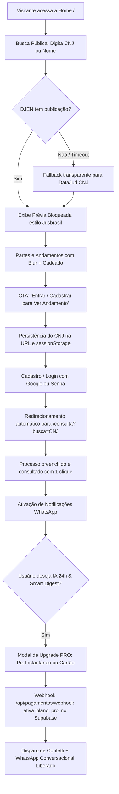

# JusConsulta — Acompanhamento Processual Inteligente

Plataforma de alta fidelidade para consulta pública, tradução em linguagem humana e acompanhamento proativo de processos judiciais brasileiros com Inteligência Artificial conversacional no WhatsApp.

Construído com **Next.js 16.4.3 (Turbopack)**, **React 19.3.1**, **TypeScript**, **Mantine v8**, **Tailwind CSS v4**, **Supabase (PostgreSQL + pgvector)**, **Upstash Redis**, **LangChain / LangGraph**, **Langfuse v3** e integrações com **DataJud (CNJ)**, **DJEN (Comunica PJe)**, **Infosimples**, **Lemit** e **WhatsApp Cloud API (Meta)**.

---

## Sumário
1. [Visão Geral & Diferenciais vs. JusBrasil](#-visão-geral--diferenciais-vs-jusbrasil)
2. [Estratégia de Rentabilização e Modelos de Cobrança](#-estratégia-de-rentabilização-e-modelos-de-cobrança)
3. [Fluxo Completo do Funil (Grátis → Pago)](#-fluxo-completo-do-funil-grátis--pago)
4. [Arquitetura & Módulos do Sistema](#-arquitetura--módulos-do-sistema)
5. [Pendências Operacionais para Produção](#-pendências-operacionais-para-produção)
   - [WhatsApp Cloud API (Meta)](#1-mensageria-whatsapp-cloud-api-meta)
   - [Gateways de Pagamento (Asaas / Stripe / Mercado Pago)](#2-gateways-de-pagamento-e-assinaturas)
6. [Testes, Homologação & Observabilidade](#-testes-homologação--observabilidade)
7. [Variáveis de Ambiente (`.env.local`)](#-variáveis-de-ambiente-envlocal)
8. [Como Executar Localmente](#-como-executar-localmente)

---

## ⚖️ Visão Geral & Diferenciais vs. JusBrasil

Enquanto plataformas legadas entregam notificações frias, cheias de jargões processuais e sem suporte a diálogo, o JusConsulta foi projetado com três pilares centrais de diferenciação:

1. **Tradução em Linguagem Humana e Empática**: Todo andamento é sintetizado em 2 a 3 parágrafos diretos (*O que aconteceu*, *O que isso significa na prática* e *O que fazer agora*), eliminando o pânico comum de partes leigas diante de despachos ordinários.
2. **WhatsApp Conversacional Bidirecional 24/7**: O cliente ou advogado responde à notificação no WhatsApp perguntando *"Vou perder minha conta?"* ou *"Qual o prazo para recorrer?"* e o Agente ReAct LangChain responde com precisão técnica ancorada nos autos reais e artigos do CPC/15.
3. **Smart Digest Anti-Spam com Filtro de Urgência**: Despachos graves (penhora, Sisbajud, intimação com prazo legal sob pena de multa) disparam alertas instantâneos no WhatsApp. Movimentações burocráticas de rotina (juntadas, certidões) são consolidadas em um resumo semanal amigável às sextas-feiras.
4. **Visão Computacional Multimodal (OCR de Intimações)**: O usuário fotografa uma intimação recebida ou encaminha o PDF no WhatsApp; a IA analisa prazos em dias úteis pelo CPC, detecta riscos patrimoniais e orienta os próximos passos.

---

## 💰 Estratégia de Rentabilização e Modelos de Cobrança

O modelo comercial do JusConsulta foi desenhado para maximizar a conversão de topo de funil gratuito em receita previsível recorrente (MRR) combinada com monetização transacional sob demanda:

```
┌─────────────────────────────────────────────────────────────────────────────┐
│                           ESTRUTURA DE PRECIFICAÇÃO                         │
├─────────────────────────┬──────────────────────────┬────────────────────────┤
│     PLANO GRATUITO      │     PLANO PRO (MRR)      │    CONSULTAS AVULSAS   │
│         R$ 0/mês        │       R$ 79,90/mês       │   R$ 19,90 a R$ 39,90  │
├─────────────────────────┼──────────────────────────┼────────────────────────┤
│ • Até 2 processos       │ • Até 50 processos       │ • Varredura completa   │
│ • Consultas DataJud     │ • WhatsApp IA 24/7       │   por CPF/CNPJ em 14   │
│ • Alertas só por e-mail │ • Smart Digest semanal   │   tribunais estaduais/ │
│ • Prévia bloqueada na   │ • OCR fotos intimações   │   federais (Infosimples│
│   busca pública         │ • Radar contínuo de CPF  │   + Lemit enriquecido) │
│ • Sem WhatsApp          │ • Tracing e suporte VIP  │ • Pagamento avulso Pix │
└─────────────────────────┴──────────────────────────┴────────────────────────┘
```

### 1. Assinatura Mensal Recorrente — Plano PRO (R$ 79,90 / mês)
- **Público**: Pessoas físicas com múltiplos litígios, empresários, autônomos e advogados autônomos.
- **Recursos Inclusos**:
  - Monitoramento ativo de até 50 processos simultâneos.
  - Atendimento conversacional contínuo com a IA direto no WhatsApp.
  - Alertas prioritários imediatos de intimações com prazo e penhora.
  - Smart Digest semanal consolidado na sexta-feira.
  - Leitura inteligente de fotos de mandados e notificações via WhatsApp (OCR).
  - Radar contínuo de novos processos distribuídos no CPF/CNPJ.
- **Cobrança**: Assinatura recorrente via Pix automático ou Cartão de Crédito com cancelamento em 1 clique sem fidelidade.

### 2. Consultas Únicas / Avulsas (Pay-Per-Query)
- **Público**: Usuários que precisam apenas de um levantamento pontual (ex.: certidão de distribuição prévia para compra de imóvel, contratação ou auditoria cadastral) e não desejam mensalidade.
- **Precificação Proposta**:
  - **Consulta Expressa por CPF (R$ 19,90)**: Varredura unificada em 14 tribunais estaduais/federais via Infosimples + resumo consolidado de processos ativos.
  - **Dossiê Jurídico & Patrimonial Completo (R$ 39,90)**: Varredura multi-tribunal + enriquecimento cadastral via Lemit + diagnóstico patrimonial de riscos de penhora/Sisbajud por processo.
- **Margem Operacional**: Custo de API da Infosimples + Lemit gira em torno de R$ 0,35 a R$ 3,50 por consulta, gerando margem bruta superior a 80%.

### 3. Nível Gratuito Estratégico (Freemium de Atração)
- Permite monitorar até 2 processos sem custo com alertas exclusivamente por e-mail.
- O canal WhatsApp e a inteligência conversacional 24h atuam como o gatilho principal de upgrade para o Plano PRO.

---

## 🔄 Fluxo Completo do Funil (Grátis → Pago)

O funil foi construído para retenção e zero atrito de conversão:



### Detalhes das Etapas:
1. **Busca Pública no Topo do Funil ([`components/BuscaPublica.tsx`](file:///d:/projetos/Andamento%20Processual/Prosec/components/BuscaPublica.tsx))**:
   - Disponível na página inicial ([`app/page.tsx`](file:///d:/projetos/Andamento%20Processual/Prosec/app/page.tsx)) sem necessidade de cadastro.
   - Consulta gratuita ao DJEN (Comunica PJe) com fallback instantâneo para a API oficial do DataJud em caso de timeout ou processo sem publicação recente.
   - Cache Upstash Redis de 6 horas por chave (`ap:djen:cnj:{digitos}`) para resposta instantânea.
2. **Prévia Bloqueada de Alta Conversão**:
   - A API pública ([`app/api/publico/busca/route.ts`](file:///d:/projetos/Andamento%20Processual/Prosec/app/api/publico/busca/route.ts)) remove intencionalmente partes, órgão julgador e teor das movimentações antes de responder ao navegador (protegendo dados e impedindo inspeção via DevTools).
   - A interface renderiza uma faixa estilizada com efeito de vidro fosco (blur) e ícone de cadeado.
3. **Persistência Pós-Login**:
   - O processo pesquisado é gravado em `sessionStorage` e repassado como query param (`/login?processo=...`).
   - Ao concluir login ou cadastro, o usuário é direcionado para [`/consulta?busca={cnj}`](file:///d:/projetos/Andamento%20Processual/Prosec/app/(app)/consulta/page.tsx) com o formulário já preenchido em modo numérico.
4. **Checkout Transparente do Plano PRO ([`components/UpgradeProModal.tsx`](file:///d:/projetos/Andamento%20Processual/Prosec/components/UpgradeProModal.tsx))**:
   - **Aba Pix Instantâneo**: QR Code vetorial dinâmico e código Pix Copia e Cola padrão BACEN com botão de cópia rápida.
   - **Aba Cartão de Crédito**: Interface com campos de cartão protegidos.
   - **Ativação e Feedback**: Integração com webhook de confirmação, animação com `canvas-confetti` e revalidação reativa do perfil do usuário via [`useSharedProfile`](file:///d:/projetos/Andamento%20Processual/Prosec/components/ProfileProvider.tsx).

---

## 🏛️ Arquitetura & Módulos do Sistema

### 1. Agente Conversacional WhatsApp ([`lib/agent/`](file:///d:/projetos/Andamento%20Processual/Prosec/lib/agent/))
- **Framework**: LangChain / LangGraph ReAct Agent monitorado integralmente pelo Langfuse v3.
- **Ferramentas Especializadas ([`lib/agent/tools.ts`](file:///d:/projetos/Andamento%20Processual/Prosec/lib/agent/tools.ts))**:
  - `consultar_processo_datajud`: Recupera dados e histórico oficial no CNJ com cache Redis de 6 horas.
  - `calcular_prazo_processual`: Calcula prazos em dias úteis do CPC/15 (art. 335 contestação, art. 1.003 apelação, art. 523 cumprimento de sentença) e regras de demora/excesso de prazo do juiz (**arts. 226 e 235 do CPC**).
  - `analisar_risco_penhora_e_bloqueio`: Avalia ordens de bloqueio Sisbajud, constrição Renajud, hasta pública/leilão e diagnostica impenhorabilidade de salário, aposentadoria e quantias até 40 salários mínimos em poupança (**art. 833, IV e X do CPC**).
  - `explicar_termo_juridico`: Decodifica jargões processuais em linguagem leiga sem alarmismo.
  - `buscar_trechos_documentos_processo`: Busca semântica (RAG) em petições e decisões indexadas com pgvector.

### 2. Mensageria WhatsApp Cloud API ([`lib/whatsapp.ts`](file:///d:/projetos/Andamento%20Processual/Prosec/lib/whatsapp.ts) & [`app/api/whatsapp/webhook/route.ts`](file:///d:/projetos/Andamento%20Processual/Prosec/app/api/whatsapp/webhook/route.ts))
- Handshake oficial Meta (`hub.challenge` e `hub.verify_token`).
- Suporte a templates HSM oficiais, mensagens interativas de botões de resposta rápida e mensagens livres dentro da janela de 24 horas.
- Opt-out estrito LGPD: qualquer mensagem contendo `SAIR`, `PARAR`, `CANCELAR` ou `STOP` desativa os alertas no banco de dados e confirma o descadastro ao usuário.
- Recepção de mídia: download seguro de fotos e PDFs da Graph API e processamento multimodal por visão computacional ([`lib/whatsappMedia.ts`](file:///d:/projetos/Andamento%20Processual/Prosec/lib/whatsappMedia.ts)).

### 3. Motor de Busca e Classificação
- [`lib/classify.ts`](file:///d:/projetos/Andamento%20Processual/Prosec/lib/classify.ts): Classifica movimentações judiciais por severidade. Intimações com prazo em dias úteis e ameaças de constrição são marcadas como `urgente`, disparando alerta imediato sem aguardar o digest semanal.
- [`lib/cnj.ts`](file:///d:/projetos/Andamento%20Processual/Prosec/lib/cnj.ts): Parser de números CNJ com mapeamento de todos os tribunais de justiça do Brasil (TJs, TRFs, TRTs, tribunais superiores).
- [`lib/djen.ts`](file:///d:/projetos/Andamento%20Processual/Prosec/lib/djen.ts): Cliente da API oficial do Diário de Justiça Eletrônico Nacional (Comunica PJe).

### 4. SEO Dinâmico & Open Graph
- [`app/processo/[cnj]/page.tsx`](file:///d:/projetos/Andamento%20Processual/Prosec/app/processo/%5Bcnj%5D/page.tsx): Página SSR com Schema.org JSON-LD (LegalService), metadados canônicos e sitemap indexável ([`app/sitemap.ts`](file:///d:/projetos/Andamento%20Processual/Prosec/app/sitemap.ts)).
- [`app/opengraph-image.tsx`](file:///d:/projetos/Andamento%20Processual/Prosec/app/opengraph-image.tsx) & [`app/processo/[cnj]/opengraph-image.tsx`](file:///d:/projetos/Andamento%20Processual/Prosec/app/processo/%5Bcnj%5D/opengraph-image.tsx): Geradores de cards dinâmicos em alta definição (1200x630) via `@vercel/og` para compartilhamento social no WhatsApp, LinkedIn e Twitter.

---

## ⚠️ Pendências Operacionais para Produção

O código da aplicação está **100% desenvolvido, testado e compilado**. Para iniciar a operação comercial com usuários reais, restam as seguintes configurações de infraestrutura externa:

### 1. Mensageria WhatsApp Cloud API (Meta)
Para envio de mensagens reais e recebimento no webhook:
- [ ] **Criar App no Meta for Developers**:
  - Acessar [developers.facebook.com](https://developers.facebook.com/) e criar um aplicativo do tipo *Empresa* com o produto *WhatsApp*.
  - Associar o número de telefone oficial do JusConsulta.
- [ ] **Configurar Variáveis de Ambiente no Host (ex.: Vercel)**:
  - `WHATSAPP_CLOUD_TOKEN`: Token de acesso permanente da Graph API gerado no Business Manager.
  - `WHATSAPP_PHONE_NUMBER_ID`: Identificador do número de telefone no painel da Meta.
  - `WHATSAPP_TEMPLATE_ANDAMENTO`: Nome do template HSM de notificação de andamento aprovado na categoria *Utilidade* (Utility).
  - `WHATSAPP_WEBHOOK_VERIFY_TOKEN`: Token secreto definido para validação do webhook (padrão configurado no código: `jusconsulta_whatsapp_secret`).
- [ ] **Cadastrar URL do Webhook no Painel da Meta**:
  - URL de retorno: `https://seu-dominio.com.br/api/whatsapp/webhook`
  - Campo assinado: Marcar o evento `messages`.

### 2. Gateways de Pagamento e Assinaturas
O endpoint unificado de webhook já está pronto em [`app/api/pagamentos/webhook/route.ts`](file:///d:/projetos/Andamento%20Processual/Prosec/app/api/pagamentos/webhook/route.ts). Resta apenas definir o provedor financeiro e apontar a URL:
- [ ] **Escolha do Provedor de Cobrança**:
  - **Asaas** (Recomendado para o mercado brasileiro: excelente suporte a Pix recorrente e cartões nacionais com baixa taxa de chargeback).
  - **Mercado Pago** (Popular para Pix instantâneo transparente).
  - **Stripe** (Ideal para pagamentos internacionais com Apple Pay e Google Pay).
- [ ] **Configurar Webhook no Painel do Provedor**:
  - Apontar a URL de Webhook para: `https://seu-dominio.com.br/api/pagamentos/webhook`
  - Eventos a escutar:
    - Asaas: `PAYMENT_CONFIRMED`, `PAYMENT_RECEIVED`
    - Stripe: `invoice.payment_succeeded`, `checkout.session.completed`
    - Mercado Pago: `payment.created`, `payment.updated`
- [ ] **Ativação em Produção**:
  - Ao receber a notificação, a rota localiza o usuário pelo e-mail ou `externalReference` (userId) e promove a conta para `plano: 'pro'` no Supabase via `atualizarPlanoUsuario`.

### 3. Observabilidade com Langfuse (Opcional, mas Recomendado)
- [ ] Criar projeto gratuito em [cloud.langfuse.com](https://cloud.langfuse.com) e definir `LANGFUSE_PUBLIC_KEY` e `LANGFUSE_SECRET_KEY` para monitoramento de custos de LLM e traces conversacionais do WhatsApp. Sem essas chaves, o sistema opera normalmente com fallback local gracioso.

---

## 🧪 Testes, Homologação & Observabilidade

A aplicação possui um pipeline rigoroso de validação contínua:

### 1. Teste de Fumaça e Homologação E2E (`npm run test:smoke`)
Executa a suíte de 17 pontos críticos em [`evals/homologacao-smoke-test.ts`](file:///d:/projetos/Andamento%20Processual/Prosec/evals/homologacao-smoke-test.ts):
```bash
npm run test:smoke
```
Valida em tempo real:
- Classificador de urgência de intimações com prazo do CPC.
- Rota de busca pública com fallback DataJud e omissão de dados sensíveis na prévia.
- Handshake do Webhook da Meta e comando de opt-out LGPD (`SAIR`).
- Webhook multi-gateway de pagamentos do Plano PRO.
- Respostas seguras e fundamentadas do Agente conversacional no WhatsApp (**Art. 833 do CPC**).

### 2. Avaliação Automatizada do Agente com LLM Juiz (`npm run eval:agente`)
Executa a bateria de 32 casos de teste em [`evals/agente-whatsapp/casos.json`](file:///d:/projetos/Andamento%20Processual/Prosec/evals/agente-whatsapp/casos.json) avaliados pelo modelo juiz GPT-4o:
```bash
# Todos os 32 casos
npm run eval:agente

# Filtro por categorias específicas
npm run eval:agente -- --so prazos
npm run eval:agente -- --so risco
```

### 3. Compilação de Produção Turbopack
```bash
npm run build
```
Valida a compilação limpa de todas as 37 rotas estáticas e dinâmicas da aplicação no Next.js 16.

---

## 🔑 Variáveis de Ambiente (`.env.local`)

Exemplo de configuração das variáveis locais e de produção:

```env
# URL Pública da Aplicação
NEXT_PUBLIC_SITE_URL=https://jusconsulta.com.br

# Banco de Dados & Autenticação (Supabase)
NEXT_PUBLIC_SUPABASE_URL=https://seu-projeto.supabase.co
NEXT_PUBLIC_SUPABASE_ANON_KEY=eyJ...
SUPABASE_SECRET_KEY=eyJ...

# Cache Distribuído (Upstash Redis)
UPSTASH_REDIS_REST_URL=https://...upstash.io
UPSTASH_REDIS_REST_TOKEN=AX...

# APIs Judiciais Oficiais
DATAJUD_API_KEY=cDZHYzlZa0JadVREZDJCendQbXBack5qSTpCWFNOZVNzc1NScTI0Z1Z0REpndGZn
INFOSIMPLES_API_TOKEN=...
LEMIT_API_TOKEN=...

# Modelos de Linguagem (IA)
OPENAI_API_KEY=sk-proj-...
ANTHROPIC_API_KEY=sk-ant-...

# WhatsApp Cloud API (Meta)
WHATSAPP_CLOUD_TOKEN=EAA...
WHATSAPP_PHONE_NUMBER_ID=1000...
WHATSAPP_TEMPLATE_ANDAMENTO=aviso_andamento_processo
WHATSAPP_WEBHOOK_VERIFY_TOKEN=jusconsulta_whatsapp_secret

# Observabilidade (Langfuse)
LANGFUSE_PUBLIC_KEY=pk-...
LANGFUSE_SECRET_KEY=sk-...
LANGFUSE_BASE_URL=https://cloud.langfuse.com

# Agendador Cron (Vercel Cron)
CRON_SECRET=...
```

---

## 💻 Como Executar Localmente

```bash
# 1. Clonar repositório e acessar pasta
cd "d:/projetos/Andamento Processual/Prosec"

# 2. Instalar dependências
npm install

# 3. Rodar suíte de homologação
npm run test:smoke

# 4. Iniciar servidor de desenvolvimento
npm run dev
```

Acesse em `http://localhost:3000` para navegar na busca pública, consultar processos e testar o modal de checkout.
