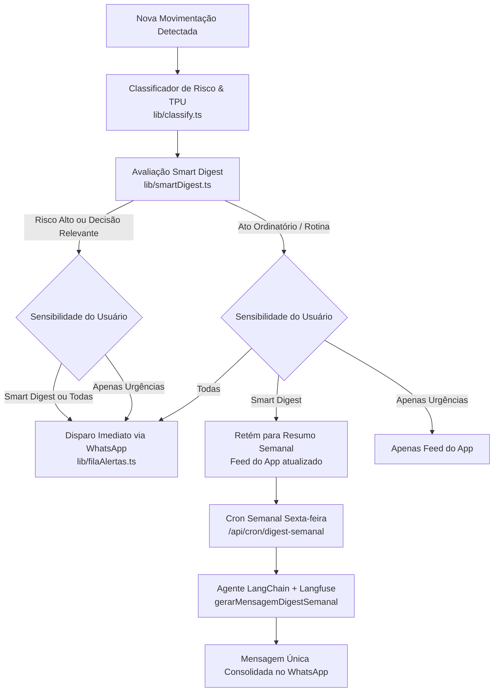

# Smart Digest — Motor Anti-Spam de Acompanhamento Processual

> **Documentação Técnica & de Produto**  
> **Arquivo**: `SMART_DIGEST.md` (Raiz do Projeto)  
> **Módulos Core**: [`lib/smartDigest.ts`](file:///d:/projetos/Andamento%20Processual/Prosec/lib/smartDigest.ts), [`lib/filaAlertas.ts`](file:///d:/projetos/Andamento%20Processual/Prosec/lib/filaAlertas.ts), [`app/api/cron/digest-semanal/route.ts`](file:///d:/projetos/Andamento%20Processual/Prosec/app/api/cron/digest-semanal/route.ts), [`components/AcompanhamentoProcessos.tsx`](file:///d:/projetos/Andamento%20Processual/Prosec/components/AcompanhamentoProcessos.tsx)

---

## 1. O Problema Resolvido

No Brasil, os sistemas tradicionais de acompanhamento processual (como o JusBrasil e diários de justiça) pecam por dois extremos:

1. **Spam burocrático e ansiedade para o cliente**: Qualquer despacho ordinatório ("Juntada de AR", "Conclusão ao Juiz", "Remessa ao Distribuidor") gera uma notificação estéril no celular do cliente, gerando pânico desnecessário e sobrecarregando o escritório de advocacia com mensagens do tipo *"Doutor, o que significa conclusão ao juiz? Eu perdi a causa?"*.
2. **Alertas estéreis e sem contexto**: Notificações que apenas colam o texto frio do Diário Oficial, sem tradução para a linguagem humana e sem indicar se é necessário agir ou se é apenas rotina forense.

O **Smart Digest** resolve esse problema separando cirurgicamente o que é **urgente** do que é **rotina**.

---

## 2. Visão Geral da Arquitetura



---

## 3. Os Três Modos de Sensibilidade

Configurados pelo próprio usuário no card de cada processo em [`components/AcompanhamentoProcessos.tsx`](file:///d:/projetos/Andamento%20Processual/Prosec/components/AcompanhamentoProcessos.tsx) e persistidos na tabela `ap_processos_monitorados` via [`app/api/monitoramento/route.ts`](file:///d:/projetos/Andamento%20Processual/Prosec/app/api/monitoramento/route.ts):

| Modo | Comportamento para Urgências (Sisbajud, Liminar, Prazo Peremptório) | Comportamento para Rotina (Juntadas, Conclusões, Remessas) | Indicação |
| :--- | :--- | :--- | :--- |
| **Smart Digest** *(Padrão Recomendado)* | Disparo **imediato** no WhatsApp em minutos. | Retido para o **Smart Digest Semanal** de sexta-feira. | Usuários que querem tranquilidade sem perder avisos graves. |
| **Todas as Movimentações** | Disparo imediato no WhatsApp. | Disparo imediato no WhatsApp a cada movimentação. | Advogados ou partes ativas em fases críticas de julgamento. |
| **Apenas Urgências** | Disparo imediato no WhatsApp. | **Silenciado** no WhatsApp (visível apenas no feed do app). | Usuários que só desejam saber se houver risco patrimonial. |

> **Nota importante**: O histórico dentro do painel web (`ap_notificacoes`) **sempre** registra todos os andamentos, garantindo rastreabilidade jurídica completa independentemente do canal externo.

---

## 4. Regras de Classificação de Urgência

A função [`avaliarPrioridadeSmartDigest`](file:///d:/projetos/Andamento%20Processual/Prosec/lib/smartDigest.ts#L22) analisa tanto o texto da movimentação quanto o resumo executivo da IA:

### Prioridade Imediata (`prioridade: 'imediata'`)
Dispara no WhatsApp no momento da reconsulta noturna quando identificado:
- **Penhoras e Risco Patrimonial**: Sisbajud, bloqueio de contas, Renajud, penhora de veículos, leilão, arrematação, desconsideração de personalidade jurídica.
- **Prazos Peremptórios**: Intimação para pagamento (Art. 523 CPC com multa de 10%), contestação, mandado de citação, audiência designada.
- **Decisões Favoráveis**: Deferimento de liminar, sentença de procedência, expedição de alvará de levantamento, arquivamento definitivo por vitória.

### Prioridade Digest (`prioridade: 'digest'`)
Retida para o consolidado semanal:
- Atos ordinatórios e de mero expediente:
  - "Concluso para despacho"
  - "Juntada de petição ou aviso de recebimento (AR)"
  - "Remessa ao distribuidor / contadoria"
  - "Aguardando decurso de prazo da parte contrária"
  - "Expedida certidão de cartório"

---

## 5. Como Funciona o Disparo do Smart Digest Semanal

O endpoint protegido [`app/api/cron/digest-semanal/route.ts`](file:///d:/projetos/Andamento%20Processual/Prosec/app/api/cron/digest-semanal/route.ts) é executado semanalmente (sexta-feira à tarde via Vercel Cron):

1. **Varredura de Monitoramentos Ativos**: Localiza todos os usuários com `notificar_whatsapp: true` e telefone válido.
2. **Janela de 7 Dias**: Coleta todas as movimentações dos processos do usuário nos últimos 7 dias em `ap_movimentacoes`.
3. **Filtro de Relevância**: Se o usuário não teve nenhuma movimentação nova na semana, nenhum spam é disparado.
4. **Agente LangChain com Observabilidade Langfuse**:
   - A função [`gerarMensagemDigestSemanal`](file:///d:/projetos/Andamento%20Processual/Prosec/lib/smartDigest.ts#L77) aciona o modelo `gpt-4o-mini` com tracing ponta a ponta no Langfuse (`tags: ['smart-digest', perfil]`).
   - O tom é adaptado dinamicamente:
     - **Perfil Cliente**: Linguagem acolhedora, humana e tranquilizadora. Esclarece que foram andamentos de rotina e que nossa tecnologia está cuidando de tudo.
     - **Perfil Advogado**: Síntese executiva e concisa, listando números de processos e status para controle de banca.
5. **Envio via Meta Cloud API**: Mensagem formatada em Markdown do WhatsApp (*negrito* e listas), com opt-out LGPD nativo.

---

## 6. Exemplo Real de Mensagem Enviada

### Exemplo para Cliente Leigo:
```text
Olá, Maria! Aqui é o seu acompanhamento inteligente da TechTie.

Nesta semana, 2 dos seus processos tiveram andamentos burocráticos de rotina:

1. Processo nº 1002345-12.2024.8.26.0100 (TJSP):
O processo foi enviado para conferência do juiz (conclusão). É uma etapa normal do procedimento.

2. Processo nº 0004567-89.2023.5.02.0001 (TRT-2):
Juntada de comprovante de entrega de documento pelos Correios.

Fique tranquila: nossa equipe e nossos sistemas continuam acompanhando tudo atentamente. Não há nenhuma ação urgente necessária de sua parte.
```

---

## 7. Rastreamento e Observabilidade (Langfuse)

Todas as execuções do Smart Digest e do classificador de urgência são auditadas em tempo real:
- **Trace ID**: `sessionId: digest_semanal_{userId}`
- **Métricas Registradas**: Latência da síntese, contagem de tokens de entrada/saída, quantidade de processos resumidos e perfil do destinatário.
- **Prevenção de Alucinação**: O prompt obriga fidelidade estrita às movimentações registradas no banco de dados.

---

## 8. Arquivos Envolvidos no Repositório

- [`lib/smartDigest.ts`](file:///d:/projetos/Andamento%20Processual/Prosec/lib/smartDigest.ts): Lógica de priorização (`avaliarPrioridadeSmartDigest`) e gerador LangChain (`gerarMensagemDigestSemanal`).
- [`lib/filaAlertas.ts`](file:///d:/projetos/Andamento%20Processual/Prosec/lib/filaAlertas.ts): Enfileiramento com respeito à sensibilidade configurada.
- [`app/api/cron/digest-semanal/route.ts`](file:///d:/projetos/Andamento%20Processual/Prosec/app/api/cron/digest-semanal/route.ts): Rota cron protegida por segredo para despacho semanal.
- [`components/AcompanhamentoProcessos.tsx`](file:///d:/projetos/Andamento%20Processual/Prosec/components/AcompanhamentoProcessos.tsx): Seletor de botões interativos no card do processo.
- [`app/api/monitoramento/route.ts`](file:///d:/projetos/Andamento%20Processual/Prosec/app/api/monitoramento/route.ts): Endpoints GET e PATCH para persistência do modo de sensibilidade.
- [`supabase/migrations/20261026170000_ap_sensibilidade_smart_digest.sql`](file:///d:/projetos/Andamento%20Processual/Prosec/supabase/migrations/20261026170000_ap_sensibilidade_smart_digest.sql): Migration SQL do controle de sensibilidade.
